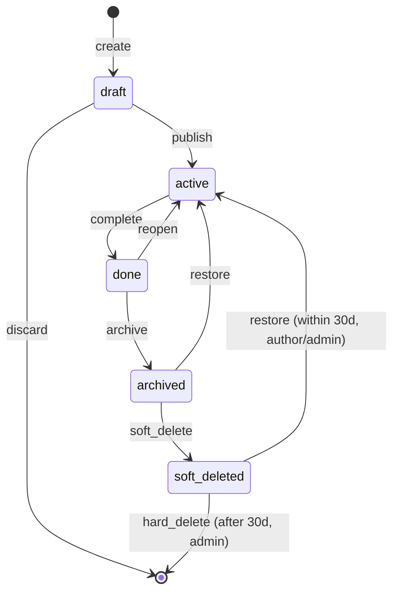
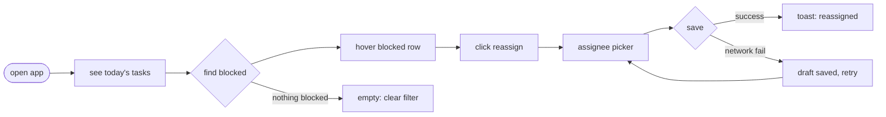

# Example — Task manager, full pipeline

> A complete worked example of this skill: from one-line idea to five-layer drafts to hi-fi restore. This is the proof the skill works. Use it as the reference for what a full run looks like.

## Input (one-line idea)

> "做一个团队用的任务管理 App"

This is exactly the kind of thin input that, fed straight to an AI, produces a plastic UI. We refuse to generate from it.

## Step 1 — Task Card (forced)

Three rounds of questions (the user is impatient, so we keep it short):

```text
TASK CARD
=========
user:
  - who: project manager at a 20-person software team
  - scenario: morning standup prep, laptop, slightly rushed
  - device: desktop (mobile later)
  - mood: rushed, wants fast answers

core task:
  - one sentence: see what's due today and reassign what's blocked
  - main flow: open app → see today's tasks → find blocked ones → reassign → done

success criteria:
  - user can reassign 5 tasks in under 60s without losing place in the list

non-goals (THIS ROUND):
  - no Gantt chart
  - no calendar view
  - no time-tracking
  - no mobile (desktop only this round)
  - no AI-summary panel

risks:
  - network slow at standup time
  - assignee has no permission to be assigned
  - due-date passed (overdue tasks)

states that can break:
  - loading: list fetch takes 2-3s on slow network
  - empty: brand-new team with no tasks yet
  - error: network fails mid-reassign, must preserve the reassign action
  - permission: viewer can't reassign
  - offline: user is on a flaky cafe wifi

data objects & lifecycle:
  - object: Task
  - states: draft → active → done → archived → soft-deleted (30d) → hard-deleted
  - key fields: title, assignee, due, status, project

permission roles:
  - viewer: can view active/done, cannot see draft/archived
  - editor: can view/edit active/done, cannot delete
  - admin: full power
  - author: special rights on own tasks (edit draft, restore soft-deleted)

one primary action per screen:
  - list page: "Create task" (or "Reassign" on hover — context primary)
  - drawer: "Save"
  - confirm: "Confirm delete"
```

## Step 2 — Five-layer slice plan

```text
slice plan:
  intent type: CRUD list-detail
  must-have drafts:
    A3 object-state-permission: Task (mandatory)
    A1 task-flow: reassign flow
    A2 state-matrix: loading / empty-3 / error / permission / offline
    A4 system: token set + component inventory
  structure drafts (3):
    B1 sidebar+list+drawer — preserves list context during reassign
    B2 kanban — status as primary axis (good for standup scan)
    B4 two-pane — dense keyboard-driven (good for power users)
  layer coverage:
    ① Task: A1 task-flow
    ② Structure: B1, B2, B4
    ③ State: A2 state-matrix + A3 object-state-permission
    ④ System: A4 system
    ⑤ Tradeoff: every draft's note
```

Every layer covered. A3 mandatory included.

## Step 3 — Stage 1 drafts

### A3 — Object-state-permission (the skeleton)



```text
PERMISSION MATRIX (object: Task)
=================================
              | view              | edit              | delete            | comment
--------------|-------------------|-------------------|-------------------|---------
draft         | author+, editor+  | author+, editor+  | author+, editor+  | -
active        | team+             | assignee+, editor+| admin only        | team+
done          | team+             | admin only        | admin only        | team+
              |                   | (reopen)          | (archive)         |
archived      | admin only        | admin only        | admin only        | -
              |                   | (restore)         | (hard-del)        |
soft_deleted  | author+,          | -                 | admin only        | -
(30d)         | admin only        |                   | (hard-del)        |
              | (restore)         |                   |                   |
```

### A1 — Task-flow (reassign)



### A2 — State-matrix (button: Save)

```text
STATE MATRIX (Button: Save)
===========================
| State    | Visual                     | Copy            | Behavior                       |
|----------|----------------------------|-----------------|--------------------------------|
| default  | primary bg                 | "Save"          | clickable                      |
| hover    | bg darken 8%               | "Save"          | cursor pointer, 100ms          |
| pressed  | bg darken 16%, scale 0.98  | "Save"          | spring back on release         |
| focus    | 2px ring outside           | "Save"          | keyboard reachable             |
| disabled | 40% opacity                | "Save" + tooltip| "fill required fields"         |
| loading  | spinner + label change     | "Saving…"       | BLOCK re-click                 |
| success  | flash green 200ms          | toast "Saved"   | confirm done                   |
| error    | shake 200ms, ring red      | "retry" inline  | preserve draft, allow retry    |
```

### B1 — Sidebar + list + drawer (ASCII)

```text
┌─────────────────────────────────────────────────────────────┐
│ TOPBAR  [logo]  search             [notif] [avatar ▾]       │
├──────────┬──────────────────────────────────┬────────────────┤
│ SIDEBAR  │ MAIN: today's tasks             │ DRAWER (opt)   │
│          │ ┌────────────────────────────┐   │ task detail    │
│ ▸ Today  │ │ □ Fix login bug   @alex ⚠│   │                │
│ ▸ Week   │ │   due today · blocked      │   │ assignee:      │
│ ▸ Proj…  │ └────────────────────────────┘   │ [@alex ▾]      │
│          │ ┌────────────────────────────┐   │                │
│          │ │ □ Design review  @sam      │   │ [Save]         │
│          │ │   due today                │   │                │
│          │ └────────────────────────────┘   │                │
│          │                                  │                │
│          │ [＋ New task]   primary          │                │
└──────────┴──────────────────────────────────┴────────────────┘
```

### B1 tradeoff note

```text
layer dug: ② Structure
good: drawer preserves list context, user batch-reassigns without losing place
cost: drawer is ~400px, can't show wide history tables
fit: task management where context preservation matters
unfit: financial records with many columns — use full page there
how it 拼: pairs with A1 (reassign flow's "save" step happens here) and A3 (drawer's edit enabled-state from matrix)
non-goals: no Gantt, no calendar (Task Card)
```

### Mosaic view

```text
MOSAIC VIEW
===========
combines into product:
  A1 task-flow + A3 object-state-permission + A2 state-matrix + A4 system
  + one of: B1 / B2 / B4

either/or:
  B1 sidebar+drawer  vs  B4 two-pane  (both preserve context; B1 simpler, B4 denser)
  B2 kanban (status-axis) — alternative for standup scan, not for batch reassign

recommendation: B1 — best fit for "reassign blocked tasks without losing place"
```

## Step 4 — User picks B1

## Step 5 — Stage 2 restore (excerpt — the Save button)

```tsx
function SaveButton({ onSave }: { onSave: () => Promise<void> }) {
  const [state, setState] = useState<'idle'|'loading'|'error'>('idle');
  const [pressed, setPressed] = useState(false);

  const handleSave = async () => {
    if (state === 'loading') return;        // block re-click
    setState('loading');
    try {
      await onSave();
      setState('idle');                      // success flash handled by toast
    } catch {
      setState('error');                     // draft preserved by parent
    }
  };

  return (
    <button
      className="btn btn-primary"
      data-pressed={pressed}
      data-error={state === 'error'}
      aria-busy={state === 'loading'}
      disabled={state === 'loading'}
      onClick={handleSave}
      onMouseDown={() => setPressed(true)}
      onMouseUp={() => setPressed(false)}
      onMouseLeave={() => setPressed(false)}
    >
      {state === 'loading' && <Spinner size={16} />}
      <span>{state === 'loading' ? 'Saving…' : 'Save'}</span>
    </button>
  );
}
```

```css
.btn { background: var(--color-state-primary); transition: all 100ms var(--easing-standard); }
.btn:hover { background: var(--color-state-hover); cursor: pointer; }
.btn[data-pressed="true"] { background: var(--color-state-active); transform: scale(0.98); }
.btn:focus-visible { outline: 2px solid var(--color-border-focus); outline-offset: 2px; }
.btn[disabled] { opacity: 0.5; cursor: not-allowed; }
.btn[data-error="true"] { animation: shake 200ms; outline-color: var(--color-danger); }
@keyframes shake { 0%,100%{transform:translateX(0)} 25%{transform:translateX(-3px)} 75%{transform:translateX(3px)} }
@media (prefers-reduced-motion: reduce) {
  .btn { transition: none; }
  .btn[data-error="true"] { animation: none; }
}
```

This button has all 8 states. It blocks re-click. It preserves draft on error. It respects reduced-motion. **This is what a human-made button looks like.**

## Step 6 — Three-gate QA (excerpt)

```text
DESIGN GATE:   PASS (one primary per screen, tokens used, 8 button states, 3-kind empty)
ENG GATE:      PASS (component split, focus-visible, aria-busy, semantic HTML, reduced-motion)
PRODUCT GATE:  PASS (reassign task start-to-end works, permission matrix enforced, no Gantt/calendar/AI-summary)
FIDELITY:      PASS (all Stage-1 blocks mapped 1:1, no drift, no added features)
MOSAIC:        PASS (all 5 layers covered)
```

## What this example proves

- The skill refuses to generate from a one-line idea.
- It forces a Task Card, then five-layer drafts, then a mosaic pick.
- Stage 2 restores 1:1 with all 8 button states, 3-kind empty states, focus rings, permission matrix enforced.
- Three-gate + fidelity + mosaic QA all pass.
- The result is NOT a plastic UI — it's a usable product surface with skeleton under the skin.
