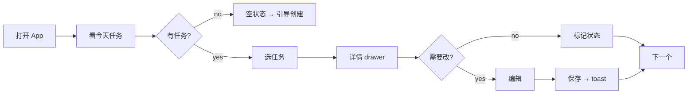
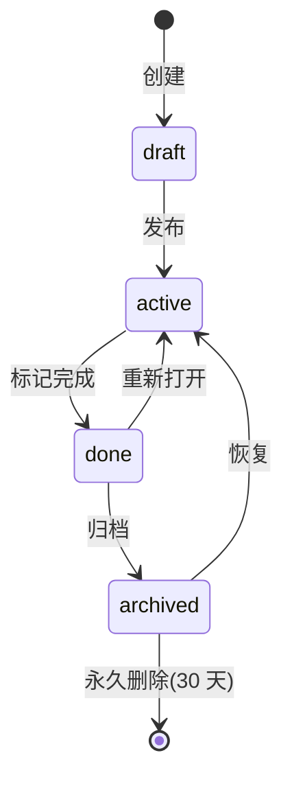

# Golden Example — 任务管理页完整跑一遍

> 这一页是**真的用 skill 跑一遍**的完整输出样本。用户说"用 design-practice 给我一个任务管理页",下面就是 skill 应该吐出来的东西。用作对照——如果生成出来的没这个深度,就是没跑完整。
>
> 这个 example 不是模板,是**质量基准**。

---

## 输入

```
用户:用 design-practice 给我一个任务管理页
```

## 阶段 0 — Intent Brief(零 gate)

```markdown
## Intent Brief

### 1. GOAL
- 类型:生产力(Productivity)
- 核心动作:用户创建/分配/跟踪任务,从 todo 到 done
- 次要动作:评论、附件、@通知、看板切换

### 2. AUDIENCE
- 类型:开发者 + SMB 团队
- 知识水平:高
- 进入情绪:理性、效率至上
- 母语:中文(双语界面)

### 3. TONE
- 主气质:严肃工程(Serious Engineering)
- 关键词:"高效"、"专业"、"键盘驱动"
- 反向气质:不要"营销感"、"卡通"

### 4. 风格 DNA 路由
- 推荐:style-linear(开发者 + 生产力 = Linear 默认)
- 理由:用户没说风格,audience+goal 锁 Linear

### 5. 关键约束
- 暗色默认(开发者偏好)
- 桌面优先
- 继承 Linear violet #5E6AD2

### 6. 反塑料锚点
- weight 510、focus 双环、progressive tracking、luminance stacking、pressed scale 0.98
```

**用户确认?** → 是,继续。

## 阶段 0.5 — Anti-Plastic Test

```text
design practice:
- user: SMB 团队的项目经理,桌面,工作时打开,情绪理性
- core task: 把脑里的 todo 变成可追踪的 task,分配给团队成员,跟踪到 done
- success criteria: 团队成员能收到任务、标记进度、完成后通知;项目经理能看全局
- non-goals: 不做 Gantt 图(这一轮);不做跨项目 portfolio(这一轮);不做工时统计(这一轮)
- states that can break:
  1. loading: 任务列表首次加载 3s,用户看到白屏
  2. empty: 新团队没任务,用户看到"暂无数据"= 失败
  3. error: 网络断时,用户正在编辑 task detail,改的内容必须不丢
  4. permission: viewer 角色看到了 Create 按钮,点了 403 = 失败
  5. repeat-click: 用户连点 Create,创建多个重复任务 = 失败
- one primary action per screen: yes(列表页=Create;详情页=Save;空状态=Create)
- data objects & lifecycle:
  - task: draft → active → done → archived → deleted
  - comment: active → edited → deleted
  - attachment: uploading → active → deleted
- permission roles:
  - owner: 全权限
  - member: 创建/编辑自己任务,评论所有
  - viewer: 只读,不能创建/编辑
- what breaks if AI just generates pretty screenshot:
  - viewer 看到 Create 按钮点 403
  - 网络断 draft 丢失
  - 长任务标题撑爆行
  - 连点创建重复任务
  - 附件上传中无进度反馈
- forbidden drift: 加 AI 自动总结 / 加日历视图 / 加工时统计(非目标)
```

**通过?** → 是,继续 Stage 1。

## 阶段 1 — Stage 1 五层切片(7 个 drafts)

### Draft 1 — Type-A 任务流(task-flow)

**挖的层**:① Task

**ASCII wireframe**(主流程):

```text
┌─────────────────────────────────────────────────────────┐
│  ⌘K  搜索...                            [通知] [+ 新建] │
├──────────┬──────────────────────────────────────────────┤
│ 收件箱   │  我的任务                  [列表] [看板]      │
│ 今天     │  ─────────────────────────────────────       │
│ 本周     │  ☐  优化首页加载性能     @张三  高  今天      │
│ ▶ 项目   │  ☐  修复登录 403 bug     @我   中  今天      │
│   Web   │  ☐  设计支付流程        @李四  高  明天      │
│   App   │  ☑  写 README           @我   低  昨天      │
│ 团队     │                                              │
│ 归档     │                                              │
└──────────┴──────────────────────────────────────────────┘
```

**Mermaid 流程**(主路径):



**State 变体**:loading(skeleton 行)/ empty(插画+"创建第一个任务")/ error(三件事:网络断+为什么+retry+本地 draft 保留)

**取舍说明**:这层挖"任务怎么从想法变 done"。好:主流程清晰。代价:不展开子任务、依赖关系(留给 System 层)。fit:todo-list 风团队。unfit:复杂项目(需要 Gantt)。

---

### Draft 2 — Type-A 状态矩阵(state-matrix)

**挖的层**:③ State

**8 状态 × 4 列矩阵**(核心组件 = 任务行):

| 状态 | 视觉 | 文案 | 行为 |
|---|---|---|---|
| default | 36px 高,白底 | "优化首页加载性能" | hover 显示操作 icon |
| hover | bg 变 rgba(255,255,255,0.05) | 同 | drag handle 淡入,操作 icon 淡入 |
| active/pressed | scale 0.98 + bg 加深 | 同 | 短暂反馈 |
| focus | 双层 box-shadow ring(2px+4px violet)| 同 | 键盘可达 |
| selected | bg 变 violet 10%,左侧 2px violet bar | 同 | 多选时全选 + 批量操作 toolbar |
| loading | skeleton 行(灰色 block) | "加载中..." | 骨架占位,不阻塞 |
| empty(initial) | 插画 + "还没有任务" + CTA | "创建你的第一个任务" | 创建按钮 |
| empty(filter) | 插画 + "没有匹配的任务" + CTA | "清除筛选" | 清筛选按钮 |
| error | 红边框 + ⚠ icon + 三件事 | "加载失败 - 网络断 - [重试]" | retry |
| dragging | 半透明 + 长 shadow | 同 | 跨列拖拽改状态 |

**取舍**:挖"任务行的所有状态"。好:覆盖 AI 常漏的 hover/focus/loading/error。代价:不挖 batch 操作(留给 Type-B 看板)。

---

### Draft 3 — Type-A 对象状态权限矩阵(最难深层)

**挖的层**:④ System + ⑤ Tradeoff

**对象生命周期 × 权限**:

| 对象 | 状态 | owner | member | viewer |
|---|---|---|---|---|
| task | draft | 创建/编辑/删除 | 创建/编辑自己/删除自己 | 看 |
| task | active | 编辑/改状态/删除 | 改状态自己/编辑自己 | 看 |
| task | done | 重新打开/归档/删除 | 改自己/重新打开自己 | 看 |
| task | archived | 恢复/永久删除 | 看 | 看 |
| task | deleted | (30 天内恢复) | (30 天内恢复自己) | 不可见 |
| comment | active | 编辑所有/删除所有 | 编辑自己/删除自己 | 看 |
| attachment | uploading | 取消/重试 | 取消自己 | 看 |
| attachment | active | 删除 | 删除自己 | 看 |

**Mermaid**(task 生命周期):



**取舍**:这层 AI 几乎从不画。挖"data lifecycle × RBAC"。好:防 viewer 看到 Create 403、防 member 改别人任务。代价:复杂(留给 System draft 实现)。

---

### Draft 4 — Type-A System(token + component)

**挖的层**:④ System

**Token 三层**(套 style-linear):
- primitive: violet #5E6AD2 / canvas #08090A / 等
- semantic: color.text.primary / color.brand / color.danger / 等
- component: button.primary.bg / input.border.focus / row.hover.bg

**Component 清单**:button / input / table-row / drawer / modal / toast / empty-state / badge / avatar / checkbox / nav-sidebar

**取舍**:挖"系统化"。好:可维护、token 化。代价:不挖新组件(只列必需的)。

---

### Draft 5 — Type-B IA 变体 1(侧栏 + 列表 + drawer)

**ASCII**:

```text
┌─────────────────────────────────────────────────┐
│ Logo  ⌘K                              [@] [+新]│
├──────────┬──────────────────────────────────────┤
│ 侧栏     │  列表                                │
│ - 收件箱 │  ──────────────────                  │
│ - 今天   │  ☐ 任务1                            │
│ - 项目   │  ☐ 任务2  ← hover 时右侧出现 icon   │
│          │  ☐ 任务3                            │
│          │                  ┌─ 详情 drawer ─┐  │
│          │                  │ 任务2 详情     │  │
│          │                  │ ...           │  │
│          │                  └───────────────┘  │
└──────────┴──────────────────────────────────────┘
```

**IA 真不同**:左导航 + 中列表 + 右详情,**3 列同时可见**。fit:任务多、频繁切换上下文。

---

### Draft 6 — Type-B IA 变体 2(看板 kanban)

**ASCII**:

```text
┌─────────────────────────────────────────────────────┐
│ Logo  ⌘K                                  [@] [+新]│
├─────────────────────────────────────────────────────┤
│  Todo       →  Doing      →  Review   →  Done      │
│  ┌────┐       ┌────┐        ┌────┐      ┌────┐      │
│  │任1 │       │任3 │        │任5 │      │任7 │      │
│  │张三│       │李四│        │王五│      │赵六│      │
│  │今天│       │明天│        │后天│      │昨天│      │
│  └────┘       └────┘        └────┘      └────┘      │
│  ┌────┐       ┌────┐                                 │
│  │任2 │       │任4 │       拖拽改列 → 改状态         │
│  └────┘       └────┘                                 │
└─────────────────────────────────────────────────────┘
```

**IA 真不同**:列 = 状态,卡片 = 任务,拖拽 = 改状态。fit:可视化工作流。unfit:任务多(看板挤)。

---

### Draft 7 — Type-B IA 变体 3(单列 + inline-edit)

**ASCII**:

```text
┌─────────────────────────────────────────┐
│ ⌘K                          [@] [+新]   │
├─────────────────────────────────────────┤
│  今天                                    │
│  ─────                                   │
│  ☐ 优化首页加载性能        @张三 高 今天 │
│    [展开 ▼] →                             │
│      ┌─ inline 编辑 ────┐                │
│      │ 描述: ______    │                │
│      │ 截止: ____      │                │
│      │ [保存] [取消]    │                │
│      └─────────────────┘                │
│  ☐ 修复登录 403 bug        @我  中 今天 │
│  ☑ 写 README              @我  低 昨天 │
└─────────────────────────────────────────┘
```

**IA 真不同**:无侧栏 / 无 drawer,所有编辑 inline 展开。fit:纯个人 todo、移动端友好。unfit:复杂项目。

---

## 阶段 1.5 — Mosaic View + 推荐

```text
拼图视图:

✓ 必选组合(拼成完整产品):
  Draft 1 (task-flow) + Draft 2 (state-matrix) + Draft 3 (object-permission)
  + Draft 4 (system) + 选一个 IA(Draft 5/6/7 之一)

⇆ 二选一(Draft 5/6/7):
  - Draft 5 (侧栏+列表+drawer):任务多、团队、桌面 → 推荐
  - Draft 6 (kanban):可视化工作流、个人 todo
  - Draft 7 (单列 inline):极简、移动端

推荐:SMB 团队 + 桌面 + 任务管理 → Draft 5。
理由:任务多需要侧栏分类,频繁看详情需要 drawer 不离开列表,kanban 对 SMB 团队过重。
```

**用户选 Draft 5。继续 Stage 2。**

## 阶段 2 — Stage 2 高保真还原(套 Linear + component 字典)

**生成的最终 Prompt**(给图像模型或 code agent):

```text
[复制 style-linear.md 的完整 Prompt Fragment]

[复制 components/nav-sidebar.md 的 Prompt Fragment]
[复制 components/table-row.md 的 Prompt Fragment]
[复制 components/drawer.md 的 Prompt Fragment]
[复制 components/button.md 的 Prompt Fragment]
[复制 components/empty-state.md 的 Prompt Fragment]
[复制 components/checkbox.md 的 Prompt Fragment]
[复制 components/avatar.md 的 Prompt Fragment]
[复制 components/badge.md 的 Prompt Fragment]
[复制 components/toast.md 的 Prompt Fragment]

页面:任务管理页(侧栏 + 列表 + drawer 三栏)
基于 Draft 5 的 ASCII wireframe 1:1 还原

[Fidelity Contract]:
- 左侧栏 240px:Logo / ⌘K / 收件箱 / 今天 / 本周 / 项目(Web, App)/ 团队 / 归档
- 中列表:36px 行高(small density),checkbox + 标题 + avatar + priority badge + date
- 右 drawer:400px,任务详情(标题 input + 描述 textarea + 元数据 + 评论)
- 顶栏:56px,⌘K search + 通知 icon + Create button
- 状态:loading(skeleton)/ empty(initial: "创建第一个任务" + 插画)/ empty(filter: "清除筛选")/ error(三件事)
- 8 button 状态:default/hover/active/focus/disabled/loading/error/success
- 微交互:checkbox 勾选 scale 0.95 + 弹回 / drag handle 淡入 / drawer 滑入 200ms ease-enter

[object-state-permission 矩阵]:实现 Draft 3 完整规则,viewer 不显示 Create 按钮
```

## 阶段 3 — 多层自检(L1-L6)

```text
L1 意图:✓ Intent Brief 完整,style-linear 匹配开发者 audience
L2 骨架:✓ 4 Type-A + 3 Type-B,每 draft 标了挖的层
L3 皮肤:✓ style-linear Prompt Fragment 复制完整,反塑料证据 12 项全勾
L4 像素:✓ 9 组件全从 components/ 拉,4px 网格无离格值
L5 QA:
  ✓ 页面五问:我是谁(SMB 团队)/ 给谁(开发者)/ 干什么(管任务)/ 下一步(创建)/ 不能做时(三态)
  ✓ 状态验收:按钮 8 态 / 输入 7 态 / 表格 9 态 / drawer 7 态 / toast 6 态 / 空 3 分类
  ✓ a11y:对比度 AA / 键盘 Tab / focus-visible 双环 / ARIA / 不只颜色 / reduced-motion
  ✓ 响应式:桌面三栏 / 平板侧栏折叠 / 手机单列 + drawer 全屏
  ✓ 坏数据:超长标题 ellipsis / 空 fallback / 0 显示 / 权限双层 / 网络断 retry / i18n
L6 原创:✓ 不是 Linear 像素克隆,是 share Linear 判断的原创 UI

→ 全过,ship。
```

## 验收要点(用这个 example 对照真实输出)

| 检查项 | 这个 example 有 | 你的输出有? |
|---|---|---|
| Intent Brief 6 字段全填 | ✓ | □ |
| Anti-Plastic Test 10 字段全填,states ≥3 真实场景 | ✓ | □ |
| Stage 1 ≥4 Type-A + ≥3 Type-B | ✓(4+3)| □ |
| 每 draft 标"挖的层" | ✓ | □ |
| 状态矩阵 8 状态 × 4 列 | ✓ | □ |
| object-state-permission 矩阵(权限×对象×状态)| ✓ | □ |
| Mosaic view + 推荐 + 理由 | ✓ | □ |
| Stage 2 复制 style-*.md Prompt Fragment | ✓ | □ |
| Stage 2 复制 components/*.md Prompt Fragment | ✓ | □ |
| Fidelity Contract 1:1 对照 | ✓ | □ |
| 多层自检 L1-L6 全勾 | ✓ | □ |

任何一项 ✗ = 这个 skill 没真跑完整,产物是塑料。

## 与其他 example 的关系

- `example-composite-prompt-task-manager.md` — 组件层如何组合(像素级)
- `example-task-manager-full.md` — 旧版完整例子(Stage 2 only)
- `example-skin-vs-skeleton.md` — 皮肤 vs 骨架对比
- `example-wireframe-to-fidelity.md` — wireframe 到高保真
- **本页 golden-task-manager.md** — 从 0 到 ship 全流程基准(最新最完整)
