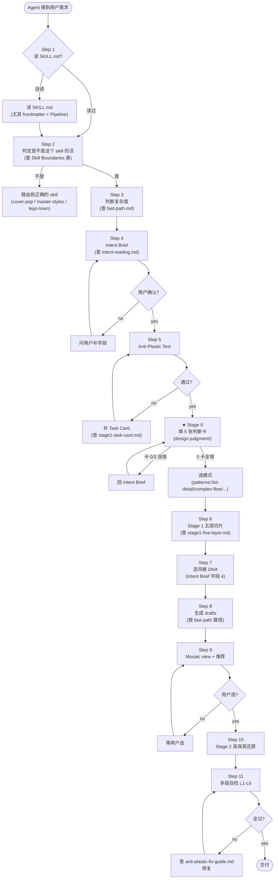

# Agent 执行手册 — Agent Playbook

> SKILL.md 是**规则文档**(what & why),这一页是**执行流程**(how step-by-step)。给 AI agent(Cursor / Codex / Claude)读完 SKILL.md 后,**第一步做什么,第二步做什么**。
>
> 不读这一页的 agent 会卡在"我知道所有规则,但不知道从哪开始"。

## ⚠️ 重要:本页是速查版,权威流程在 workflow/

**作者原文有两套权威工作流**,我之前自拼的 11 步已经被它们替代:

| 工作流 | 文件 | 适用 |
|---|---|---|
| **10 步工作流** | `workflow/01-ten-step-flow.md` | **单页 / 简单需求**(默认) |
| **8 步项目实战** | `workflow/05-eight-step-project.md` | **复杂产品 / 多页面 / 多角色** |

下面这 11 步是 10 步工作流的速查版,具体每步的细节请回到 workflow/01 的"每步详解"。

## Agent 执行流程图



## Step-by-Step 详细步骤

### Step 1:读 SKILL.md(必做)

**动作**:读 SKILL.md 全文,尤其:
- frontmatter 的 `description`(理解能做什么、不能做什么)
- "Skill Boundaries"(确认是这 skill 的活)
- "The Pipeline" mermaid 流程图
- "Failure Mode Library"(防患未然)
- "Depth Layers — the References"(知道有哪些 reference 可调)

**输出**:心里清楚整个流程,知道每步对应的 reference。

**反模式**:跳过这步直接干 → 会漏关键 gate。

---

### Step 2:判定是不是这个 skill 的活

**动作**:对照 SKILL.md 的 "Skill Boundaries" 表:

| 用户说 | 路由到 |
|---|---|
| "做个可用产品 UI / dashboard / 后台 / 表单" | **design-practice**(这个 skill)|
| "做单张社交封面 / click-bait" | cover-pop |
| "做表情包 / emoji pack" | sticker-set |
| "做水墨金句卡 / 排名卡" | quote-cards / rank-cards |
| "做单张插画 / master 风格图" | master-styles |
| "做系统结构图 / 流程图说明" | lego-town / busy-town |

**判定规则**:
- 如果能指出"一个用户任务 + 一个会坏的状态",→ 这个 skill
- 如果只是"一张好看的图",→ cover-pop / master-styles
- 如果是"解释系统怎么工作",→ lego-town

**反模式**:接单不判定 → 帮用户做封面,完全跑偏。

---

### Step 3:判断复杂度

**动作**:读 `references/fast-path.md`,根据需求复杂度选路径:

```text
单页 + 单状态 → 极简路径(1-2 drafts,10 分钟)
多状态 + 多组件 → 标准路径(3-5 drafts,30 分钟)
多角色 + 多对象 + 多状态 → 完整路径(5-8 drafts,1 小时)
```

**判断维度**:页面数、对象数、状态数、角色数、组件数、工作流深度(查 fast-path.md 决策表)。

**反模式**:不分复杂度,所有需求都跑 5-8 drafts → 简单需求用户等死,过度工程。

---

### Step 4:Intent Brief(零 gate,不能跳)

**动作**:
1. 读 `references/intent-reading.md`
2. 跟用户对话(或从描述推断),填 Intent Brief 6 字段:
   - GOAL
   - AUDIENCE
   - TONE
   - 风格 DNA 路由
   - 反向气质
   - 反塑料锚点
3. **给用户确认**(可选,如果推断很明确可以跳)

**关键**:风格 DNA 路由是核心。查 intent-reading.md 的路由表:
- audience = 开发者 → style-linear
- goal = 支付 → style-stripe
- audience = 中文消费者 → **style-chinese-saas**(skill 默认中文!)
- audience = 非工程师 + 知识管理 → style-notion
- audience = 极客 + 平台 → style-vercel

**冲突解决**:用户说的风格和 intent 推断冲突时,查 intent-reading.md 的"风格冲突解决规则"。**主动提示用户冲突**,让用户选。

**反模式**:跳过这步直接做 → 风格错配,做出来是塑料。

---

### Step 5:Anti-Plastic Test(第一 gate)

**动作**:
1. 读 SKILL.md 的 Anti-Plastic Test 10 字段
2. 填字段(参考 Three-tier answer key 判断质量)
3. 如果 `core task` 或 `≥3 states` 模糊,回 `references/stage1-task-card.md` 补 Task Card

**关键字段**:
- `states that can break`:至少 3 个真实场景(loading 几秒?empty 什么情况?error 网络断 draft 丢?)
- `data objects & lifecycle`:对象的状态机(draft/active/done/archived/deleted)
- `permission roles`:谁能 view/edit/delete

**反模式**:填"all states" / "standard states" → Bad,回 Task Card。

---

### Step 5.5(NEW):Stage 0 — 填 5 张判断卡(判断层,不能跳)

**为什么这步必须做**:Stage 1 五层切片解决"骨架怎么画",但不解决"这一仗是什么、复杂度归谁、视觉层级在哪"。判断层是《设计的实践》27 章的核心,也是 AI 工具最常跳过的一层。**跳过 Stage 0 是 CRM demo 翻车的直接原因** —— 整页所有元素字重一样、accent 滥用,因为没有填视觉层级判断卡。

**动作**(顺序不能跳):

1. 读 `design-judgment/README.md`,理解 5 张卡顺序
2. **Card 0 — task-field**(Ch 2,18 次提及):
   - 这一仗的主任务(动词开头一句话)
   - 用户路径图(进入 → 第一眼 → 扫视 → 点击 → 处理 → 反馈 → 出口)
   - **如果填不出第 1 行 → 回 Intent Brief 重问**
3. **Card 1 — complexity-conservation**(Ch 4):
   - 列出用户脑子里会冒出的全部疑问(5–15 条)
   - 每条归谁(用户/系统/团队/AI)
   - 默认值清单(系统该替用户先定什么)
4. **Card 2 — true-vs-empty-simple**(Ch 5):
   - 主路径几步(应 ≤3)
   - 5 个异常都想全了吗(错/脏/权限/中断/撤销)
   - 诚实回答:你的简是"没想全"还是"想全了"
5. **Card 3 — visual-hierarchy**(Ch 7,22 次提及) ← **最关键的一张**:
   - 层级三问:第一眼看什么 / 第二眼看什么 / 可以不看什么
   - 视觉权重 5-3-2 分配(权重 5 的元素最多 3 个)
   - 主色用在哪 3 类(主按钮/状态/链接),不得超过
   - **闭眼 1 秒测试**:睁眼第一眼看到的应该是主任务
6. **Card 4 — task-network**(Ch 13,33 次提及,仅 App 类必填):
   - 3 个主任务(角色+动词+对象+目的)
   - 任务网络图(连续/触发/回退/并行)
   - 每个任务的入口和出口
   - 断头任务数(应 0)、重复入口数(应 0)

**Gate**:
- Card 0 第 1 行空 → 回 Step 4 Intent Brief
- Card 3 空 → 不准进 Step 6,因为 Stage 1 wireframe 会平均分配注意力

**反模式**:
- 跳过 Stage 0 直接画 wireframe → 产物"骨架对的,身体错的"
- 只填 Card 0 不填 Card 3 → 视觉层级失败,整页平
- 把 Card 4 (App 级) 填给单页需求 → 过度工程

---

### Step 5.6(NEW):选模式(Patterns Layer)

**动作**:基于 Stage 0 的判断,选定主模式:

| 判断结果 | 模式 | 文件 |
|---|---|---|
| 主任务是"从一堆对象里找 + 处理" | **列表-详情**(B 端最高频,61 次提及) | `patterns/01-list-detail.md` |
| 主任务是"多步骤流程,不能中断" | **复杂流程**(向导/分支/草稿,46 次) | `patterns/02-complex-flow.md` |
| 任何"操作"都需要选容器 | **容器决策树** | `patterns/03-container-decision.md` |
| 任何"反馈"都需要选位置 | **反馈决策树** | `patterns/04-feedback-decision.md` |

**模式卡**:打开对应模式文件,填文件末尾的"模式卡"。
- 列表-详情卡:第一眼/第二眼/第三层字段 + 详情五区 + 打开方式 + 状态矩阵
- 复杂流程卡:入口 + 步骤必要性 + 分支 + 5 种回退 + 草稿

**反模式**:不选模式直接画 → 容器用错(什么都用模态)、列表字段平铺、复杂流程无草稿。

---

### Step 6:Stage 1 五层切片准备

**动作**:读 `references/stage1-five-layer.md`,理解五层:
- ① Task — 任务流程
- ② Structure — IA / 容器
- ③ State — 状态矩阵
- ④ System — token / 组件
- ⑤ Tradeoff — 取舍

每个 draft 挖**一层**到骨。

---

### Step 7:选风格 DNA(从 Intent Brief 字段 4)

**动作**:打开对应的 `visual-language/style-<linear|stripe|notion|vercel|chinese-saas>.md`,心里记住:
- 配色 token
- 字体 + weight + tracking
- 圆角
- 阴影哲学
- 动效曲线
- 图标库

**注意**:Stage 1 是**线稿阶段**(D5 低保真铁律)——不用视觉 token,但**心里要知道目标风格**,因为 IA 和组件选择受风格影响(Linear 表格密集 vs Notion block 流)。

---

### Step 8:生成 drafts(按 fast-path 路径)

**动作**:

#### 极简路径(1-2 drafts):
- 1 个 Type-B IA 变体
- 可选 1 个 Type-A 简化状态矩阵

#### 标准路径(3-5 drafts):
- 1-2 Type-A(state-matrix 必有,object-permission 视情况)
- 2-3 Type-B IA 变体

#### 完整路径(5-8 drafts):
- 4 Type-A:task-flow / state-matrix / object-state-permission / system
- 3-5 Type-B IA 变体(查 `stage1-ia-containers.md`)

**每个 draft 输出**(查 `stage1-output-formats.md`):
- 至少 2 个格式(ASCII + Mermaid + grayscale prompt + Markdown,选 layer 相关的 2 个)
- 状态变体(loading + empty 3 种 + error)
- 取舍说明(哪层 / 怎么拼成产品)

**每个 draft 标"挖的层"**:① Task / ② Structure / ③ State / ④ System / ⑤ Tradeoff。

**反模式**:8 个 Type-B 没有 Type-A → 失败模式 #1(skin without skeleton)。

---

### Step 9:Mosaic view + 推荐

**动作**:
1. 列出 drafts 怎么拼:
   - ✓ 必选组合:task-flow + state-matrix + object-permission + system + 1 个 IA
   - ⇆ 二选一:IA 变体之间
2. 给推荐组合 + 理由(从用户 task / scenario)
3. **等用户选**——不要自己定

**反模式**:直接做 Stage 2 不等用户选 → 剥夺用户决策权。

---

### Step 10:Stage 2 高保真还原

**动作**(用户选完后):

1. **选风格 DNA Prompt Fragment**:打开 `visual-language/style-<routed>.md`,复制 Prompt Fragment(EN 或 CN)。

2. **列组件清单**:从选定的 IA draft,列出所有组件(如 button / input / drawer / table-row / 等)。

3. **每个组件复制 Prompt Fragment**:打开 `components/<name>.md`,复制其 Prompt Fragment。

4. **加 Fidelity Contract**:基于选定的 IA wireframe 1:1 还原,列出每个区块的尺寸 / 状态 / 微交互。

5. **加 object-state-permission 实现**:把 Stage 1 的矩阵实现进代码(viewer 不显示 Create 等)。

6. **生成完整 prompt**:把以上拼成给图像模型或 code agent 的最终 prompt。

**反模式**:不套视觉语言 token / 不套组件字典 → 失败模式 #13(临时编组件规格)。

---

### Step 11:多层自检 L1-L6

**动作**:对生成的产物,跑 SKILL.md 的 6 层 Swap Test:

```
L1 意图:Intent Brief 字段全填?风格匹配 audience?
L2 骨架:≥2 Type-A?≥3 Type-B?每 draft 标层?
L3 皮肤:style-*.md Prompt Fragment 复制?反塑料证据全勾?单一图标库?
L4 像素:组件从 components/*.md 拉?4px 网格?
L5 QA:五问 / 状态验收 / a11y / 响应式 / 坏数据 全过?
L6 原创:不是 Linear 像素克隆?UI 文案没工程黑话?
```

**任何一层失败 → 查 `anti-plastic-fix-guide.md` 修复 → 重跑**。

**反模式**:"看起来不错"就交付 → 没跑自检,留下塑料。

### Step 12(NEW):Stage 3 — 渲染闭环(过了文字自检 ≠ 可交付)

**为什么必须做**:L1-L6 是文字自检,挡不住"渲染出来才暴露"的硬伤(404、移动端溢出、对比不足、层级扁平、AI median)。**没渲染过 = 没做完。**

**动作**:
1. `cd tooling && npm i && npx playwright install chromium`(首次)
2. `node tooling/render-critique.mjs <生成的 html>` → 出 `report.md` + 3 张截图(1440/768/390)
3. **先看 Gate**:console error / serious axe / 390 溢出 → 报告里点名了,立刻修
4. **打开 3 张截图**,自己给 hierarchy / typography / restraint 三个主观维打分(harness 不替你打)
5. 取**最弱的那一维** → 只修它 → 重跑
6. 循环到 **10 维全 ≥4** 或封顶 **4 轮**;然后跑 `references/craft-details-invisible.md` 的复利细节 audit
7. 评分标准见 `references/rubric-10d.md`

**反模式**:截图都不看就说"做完了" / 一次性重写而不是只修最弱项 / 把 image-gen 的 UI 图当真参考(那是 skin without skeleton,只可做品牌/编辑类 mood)。

## Agent 常见错误(Agent Self-Check)

每完成一步,问自己:

```text
□ 我读 SKILL.md 了吗?(还是凭训练记忆?)
□ 我判定了是不是这 skill 的活?(还是直接接单?)
□ 我判断了复杂度?(还是默认跑完整 7 drafts?)
□ 我填了 Intent Brief?(还是跳过直接做?)
□ 我跑 Anti-Plastic Test 了?(还是假设用户都懂?)
□ 我每个 draft 标了挖的层?(还是 8 个 Type-B?)
□ 我等用户选了?(还是直接进 Stage 2?)
□ 我套了视觉语言 + 组件字典?(还是临时编?)
□ 我跑了多层自检?(还是"看起来不错"就交付?)
```

任何一条 ✗,**回那一步重做**。

## 速度优化(给有经验的 Agent)

| 场景 | 优化 |
|---|---|
| 用户明确说"Linear 风格任务管理" | 跳 Intent Brief 的"风格 DNA"字段(已明确),但仍填其他 5 字段 |
| 用户说"快速给我个登录页" | 走 fast-path 极简路径,2 drafts,15 分钟交付 |
| 用户说"我们之前聊过这个产品" | 读历史 conversation,跳 Intent Brief 已知字段 |
| Agent 之前跑过相同类型 | 缓存 Stage 1 模板,只改差异点 |

**绝禁优化**:
- 跳 Anti-Plastic Test(任何场景)
- 跳多层自检(任何场景)
- 跳 Stage 1 直接 Stage 2(任何场景)
- 用训练记忆替代读 reference(任何场景)

## 失败诊断

Agent 跑挂了,按这个表诊断:

| 症状 | 病因 | 修复 |
|---|---|---|
| 用户说"不对,不是这感觉" | Intent Brief 没填或风格错配 | 回 Step 4,重填 Intent Brief,确认风格 |
| 用户说"太复杂了,简单点" | 走错路径(应该走极简,走了完整)| 回 Step 3,降级路径 |
| 用户说"5 个看起来都一样" | variation-engine 没跑 Anti-Sameness | 跑 `variation-engine.md` 9 轴变化 |
| 产物"好看但用不了" | 跳了状态/权限/object 层 | 补 Type-A depth drafts |
| 产物"功能对但风格怪" | 视觉语言 token 没套 | 复制 `visual-language/style-*.md` Prompt Fragment |
| 产物"组件尺寸乱" | 临时编组件规格 | 从 `components/*.md` 拉规格 |
| 产物"通过但用户不满意" | 多层自检没跑 L6 原创 / 没跑 L5 QA | 跑 6 层 Swap Test |

## 与 SKILL.md 的关系

SKILL.md 是**规则和为什么**(what & why),这一页是**怎么执行**(how)。Agent 两个都读——先读 SKILL.md 理解规则,再读这一页按步执行。

## 与 fast-path.md 的关系

fast-path.md 帮 Step 3 判断复杂度。这一页调用 fast-path 决定 draft 数量。

## 与 anti-plastic-fix-guide.md 的关系

anti-plastic-fix-guide.md 在 Step 11 多层自检失败后调用——查"怎么修"。

## 权威信源

- agent workflow pattern — Anthropic / OpenAI agent guide
- lego-town/SKILL.md 的 agent 执行流程(用户旗舰 skill 标准)
- "Chain of Thought" — Wei et al.
- "ReAct: Reasoning + Acting" — Yao et al.
