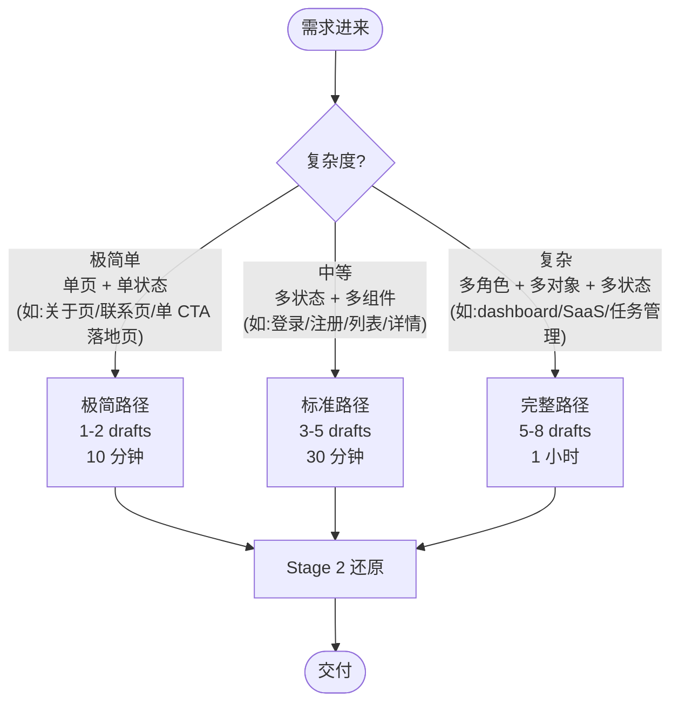

# 快速路径 — Fast Path Selection

> 不是每次都要跑完整 5-8 draft + 全部 Type-A + Type-B。简单需求走完整流程是过度工程,用户会等不及。
>
> 这一页根据需求**复杂度**路由到三条路径——新手路径、标准路径、极简路径。**任何需求先进来选路径,再决定 draft 数量**。

## 三条路径决策树



## 路径 1:极简路径(1-2 drafts)

**适用**:单页 + 单一主要状态(无复杂状态矩阵、无权限分层、无对象生命周期)。

| 适合 | 不适合 |
|---|---|
| 关于页(About)| dashboard(多状态)|
| 联系页(Contact)| 任务管理(多对象)|
| 单 CTA 落地页(订阅 newsletter)| SaaS 后台(多权限)|
| 404 / 500 错误页 | 表单流程(多步)|
| 简单公告页 | 列表 + 详情(双对象)|
| 简单产品介绍单页 | 设置页(多 tab) |

**draft 数量**:1-2 个

**draft 内容**:
- 1 个 Type-B IA 变体(就一个,因为是单页)
- 可选 1 个 Type-A 简化状态矩阵(loading + empty + error)

**跳过**:
- object-state-permission 矩阵(单页无对象)
- 5-8 发散(没必要)
- Mosaic view(只有 1-2 个 draft)

**仍然必做**:
- Intent Brief(零 gate 不能跳)
- Anti-Plastic Test 简化版(至少 core task + 1 个 state)
- Stage 2 套 style-*.md + components/*.md
- 多层自检 L1, L3, L4, L6(L2 跳,L5 简化)

**示例**(单 CTA newsletter 订阅页):

```text
draft 1 (Type-B,IA 变体):
  - 居中单列 hero + email input + subscribe button
  - 状态:loading(submit 时)/ success("订阅成功,请查收邮件")/ error(邮箱格式错)

跳过:object-permission、Mosaic、Type-A 状态矩阵(就一个组件)
```

## 路径 2:标准路径(3-5 drafts)

**适用**:多状态 + 多组件,但无复杂权限/对象生命周期。

| 适合 | 不适合 |
|---|---|
| 登录/注册 | SaaS 后台(多对象权限)|
| 简单列表 + 详情 | 任务管理(对象 lifecycle)|
| 简单表单流程(2-3 步)| 复杂工作流 |
| 设置页(单 tab)| 多角色企业应用 |
| 简单搜索结果页 | dashboard(多数据源)|

**draft 数量**:3-5 个

**draft 内容**:
- 1-2 个 Type-A(至少 state-matrix;object-permission 视情况)
- 2-3 个 Type-B IA 变体

**仍然必做**:
- Intent Brief
- Anti-Plastic Test 完整
- Stage 2 完整
- 多层自检 L1-L6

**示例**(登录页):

```text
draft 1 (Type-A state-matrix):
  - 输入框 7 状态(default/focus/filled/error/disabled/required/password)
  - 按钮 8 状态(含 loading 防双击)
  - 表单状态:empty / submitting / success / error(密码错)/ error(网络断)

draft 2 (Type-B IA):居中卡片,Logo + email + password + 登录 button + 忘记密码 link + 注册 link

draft 3 (Type-B IA):左右分屏,左侧 hero 文案 + 插画,右侧表单

draft 4 (Type-A object-permission,简化):
  - 用户对象:visitor(未登录)/ user(已登录)/ locked(账户锁定)
  - 仅 visitor 看到登录页

Mosaic:Draft 2 或 3 二选一(用户选),Draft 1 + 4 必选
```

## 路径 3:完整路径(5-8 drafts)

**适用**:多角色 + 多对象 + 多状态 + 复杂工作流。

| 适合 |
|---|
| SaaS dashboard |
| 任务管理 / 项目管理 |
| CRM / ERP |
| 企业后台 / admin console |
| 协作工具(评论 / 附件 / 通知) |
| 多角色产品(owner / member / viewer)|
| 数据密集应用(表格 + 图表 + 详情)|

**draft 数量**:5-8 个(完整 Type-A 4 + Type-B 3-5)

**完整流程**:见 SKILL.md 和 `examples/golden-task-manager.md`。

## 怎么判断复杂度(决策规则)

| 维度 | 极简 | 标准 | 完整 |
|---|---|---|---|
| 页面数 | 1 | 1-2 | 3+(或带导航)|
| 主要对象 | 0-1 | 1-2 | 3+ |
| 状态数 | 1-2 | 3-5 | 6+ |
| 角色数 | 1 | 1-2 | 3+ |
| 组件数 | 1-3 | 4-8 | 9+ |
| 工作流深度 | 单步 | 2-3 步 | 多步 + 分支 |

**判断规则**:数 6 个维度,任意 3+ 个落在"完整"列 → 走完整路径。否则标准或极简。

## 反过度工程警示

| 症状 | 病因 | 修复 |
|---|---|---|
| 单页 About 走了 7 drafts | 默认走完整路径 | 极简路径,1-2 drafts |
| 登录页跑了 object-permission 矩阵 | 不分复杂度 | 标准路径,简化 object-permission |
| 用户等了 1 小时还没看到东西 | 不出 Mosaic 不让用户选 | 每 2-3 drafts 让用户看,不憋大招 |
| 简单需求 8 个 IA 变体 | 强行发散 | 极简只 1 个,标准 2-3 个 |

## 反漏深度警示

| 症状 | 病因 | 修复 |
|---|---|---|
| SaaS 后台只画了 1 个 wireframe | 偷懒走极简 | 完整路径,5-8 drafts |
| 任务管理没画 object-permission | 跳过 Type-A | 完整路径必含 object-permission |
| Dashboard 没状态矩阵 | 只画 sunny day | 至少 Type-A state-matrix |
| 多角色产品没权限矩阵 | 跳过深层 | 完整路径必含 object-state-permission |

## 快速判断模板(用户说需求时)

```text
用户:"做个 X"

快速判断:
- 单页? → 极简
- 多页或多状态? → 标准
- 多角色或多对象或多工作流? → 完整

如果不确定,**默认走标准路径**(3-5 drafts)。
宁可多一个 draft,不要漏深度。
```

## 与 SKILL.md 的关系

SKILL.md 的 Stage 1 默认说 "5-8 drafts",**这一页是补充**——简单需求允许跳到极简或标准路径。但**零 gate(Intent Brief)+ Anti-Plastic Test 不能跳**,所有路径都要过。

## 与 golden-task-manager.md 的关系

`golden-task-manager.md` 展示的是**完整路径**(7 drafts)。如果是简单需求(如登录页),走标准路径 3-5 drafts 即可,不必跑完整 7 个。

## 权威信源

- "Right-sizing the design process" — Jared Spool
- "Don't over-engineer simple problems" — Refactoring UI
- lean UX / 设计冲刺(Design Sprint)方法论
