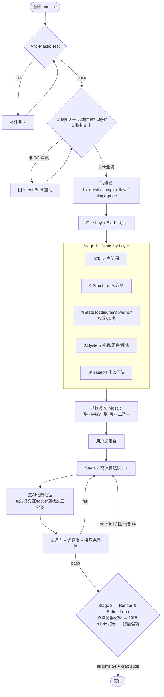

# Design Practice / 设计的实践

## ⚠️ Context budget（2026-08-01 · 硬纪律）

**本技能不是 UI 任务的默认路由。** 普通改 UI → 用 vault `04-Prompts/UI铁律-速查卡.md` / Cursor `ui-design-gate.mdc`。

打开本技能后的阅读顺序（禁止颠倒）：

1. 只执行下方 **Executable Core（TL;DR）** + `references/fast-path.md`  
2. 按需再打开**单个** reference（一次一个）  
3. **永禁默认读取** `references/source-full.md`（原文巨长，除非用户明确要求引用原文）  
4. **禁止**一上来通读本仓库 / 通读 `agent-playbook.md` 全文；playbook 仅在 Executable Core 不够用时按节查阅  

Design Practice turns a one-line idea into a **world-class product UI** by refusing what every AI-generated UI suffers from: **skin without skeleton**. The article line 3253 nails it — *"you see the skin, not the skeleton; the truly powerful parts of a great product are hidden where you don't look first: defaults, empty states, edges, keyboard paths, error recovery, permission wording, data density, information tradeoffs."*

> **If you are an AI agent reading this skill:** start with **Executable Core** below + `references/fast-path.md`. Do **not** preload the whole skill tree.

## ⚡ Executable Core (TL;DR — the spine; everything below is depth-on-demand)

The skill is large; this is the minimal path. An agent that does only these 6 steps, well, already beats the median.

1. **Intent + direction** — freeze GOAL×AUDIENCE×TONE, then commit to ONE direction from `references/world-class-teardowns/00-moodboard-tokens.md`. Never mix directions.
2. **Skeleton before skin** — name the job, the states that break (loading/empty/error/permission), the object-state-permission matrix (Stage 0 + Stage 1). A page is what survives ugly data, a failed network, and 390px.
3. **Generate grounded** — pull real values from `tokens/00-token-synthesis.md`; obey the **NEVER list** (Stage 3); real content (no lorem); one owned accent (not indigo).
4. **Render & loop (Stage 3)** — `node tooling/render-critique.mjs <file>` → fix the gate → **look at the screenshots** → score 10 dims (`references/rubric-10d.md`) → fix the **single weakest** → repeat ≤4×.
5. **Craft pass** — run the Compound-Craft Audit (`references/craft-details-invisible.md`): the dozens of invisible 0.1-details that compound into 质变 (4/5 → SSS).
6. **Ship** only when all 10 dims ≥4 and the gate passes. "Done" requires a render, not a vibe.

**Genre bar:** utility (CRM / dashboard / settings) → SSS = *invisible perfection*, no wow moment. Brand / landing / editorial → SSS = *one composed moment* + the craft layer underneath.

默认面向中文产品/文档配图;用户使用英文时再切换英文输出。

This skill exists because AI-generated UIs die one way: **they are fast hands that don't know weight** (line 1611). They draw buttons, lay out cards, write Tailwind, generate a whole dashboard — but without discipline they skip states, skip empty states, skip permissions, skip errors, skip responsive, skip design tokens. They look like a UI, but they have no skeleton. This skill's job is to force the skeleton in **before** the skin, using the article's own Five-Layer Blade as the harness.

## The One Sentence

**好设计不是静态截图好看,而是用户从"准备做"到"做完了"的整条路径都可靠。** (line 714) — and a reliable path needs all five layers, not just the picture.

## Skill Boundaries — When to Use This, Not a Neighbor

| The user wants… | Use | Why |
| --- | --- | --- |
| a usable product UI with states + tokens + depth | **design-practice** | only this skill forces the five-layer skeleton |
| a single social cover / click-bait thumbnail | cover-pop | one image, no states |
| a sticker set / emoji pack | sticker-set | characters, not UI |
| an ink-wash quote / rank card | quote-cards / rank-cards | one card, no IA |
| a pure illustration in a master's aesthetic | master-styles | image, not product |
| a structural diagram of how a system works | lego-town / busy-town | explain, not use |

Borderline:
- "做一个 Linear 风格的 dashboard" → if they want a **usable dashboard with states**, use **design-practice**; if they just want a **pretty screenshot**, that's the failure mode this skill refuses — route to master-styles or push back.
- "画一个登录页" → if it's a real login with error/loading/disabled/2FA/empty-validation states, use **design-practice**; if it's one hero shot, use cover-pop.

If you cannot point at a user task + a state that can break, do not use this skill.

## The Intent Reading — the Zeroth Gate (BEFORE the Anti-Plastic Test)

Before anything else, freeze the user's intent. A vague "做个登录页" could mean SaaS admin login, consumer App login, or marketing signup — three completely different visual decisions. **Skipping intent reading is why a perfectly precise button dictionary still produces plastic**: the style DNA was wrong for the audience.

Read `references/intent-reading.md` FIRST and fill the Intent Brief:

```text
intent brief:
- GOAL (转化 / 激活 / 留存 / 生产力 / 信息消费 / 探索 / 支付 / 配置):
- AUDIENCE (开发者 / 企业用户 / SMB / 消费者 / 专业用户 / 管理员):
- TONE (严肃工程 / 可信金融 / 温暖亲和 / 极客前沿 / 优雅奢华):
- 风格 DNA 路由 (style-linear / style-stripe / style-notion / style-vercel):
- 反向气质 (不要的感觉):
- 反塑料锚点 (这个产品的"人做的"信号 1-3 条):
```

The Intent Brief's "invariants" are then carried into the Anti-Plastic Test and through to Stage 2. If audience = developers, route to `visual-language/style-linear.md`. If audience = consumers, route to `visual-language/style-notion.md`. If goal = payment, route to `visual-language/style-stripe.md`. **Default when unclear: style-linear (2026 SaaS visual convention).**

## The Anti-Plastic Test — the First Gate

After Intent Brief is frozen, answer every field. **The Test is a gate**: if `core task` or `≥3 states that can break` is vague, do NOT proceed — make the user fill the Task Card first (`references/stage1-task-card.md`).

```text
design practice:
- user (who, scenario, device, mood):
- core task (one sentence, the thing they came to do):
- success criteria (how do we know it's done):
- non-goals (what we are NOT doing this round):
- states that can break (name ≥3 real ones: loading / empty / error / permission / offline / repeat-click / invalid-data / long-text):
- one primary action per screen (yes/no — if no, IA is wrong):
- data objects & lifecycle (draft / active / done / archived / deleted — name them):
- permission roles (who can view / edit / delete — name them):
- what breaks if an AI just generates a pretty screenshot:
- forbidden drift:
```

### Three-tier answer key (per tricky field)

**`states that can break`**
- **Good (proceed):** "loading: list fetch takes 3s; empty: new team with no tasks; error: network fails mid-submit and draft must survive; permission: viewer can't create." — four real, content-specific states.
- **Borderline:** "loading, empty, error" with no scenario — tighten: name the exact moment each fires.
- **Bad (do not proceed):** "all the states" / "whatever's standard" — route back to Task Card.

**`what breaks if an AI just generates a pretty screenshot`**
- **Good:** "The viewer role would silently see a Create button that 403s on click; the offline draft would be lost; the long task title would overflow the row." — names the exact skeleton gap.
- **Borderline:** "it would miss states" — name which state and which user.
- **Bad:** "it wouldn't look as good" — that's a skin complaint, not a skeleton complaint; wrong skill.

**One-Primary-Action Test:** if a screen has two primary buttons, the IA is wrong — fix the IA before generating. A pretty screenshot with two blue buttons is the most common AI-plastic tell.

## Stage 0 — Judgment Layer (BEFORE Stage 1, the layer AI tools most reliably skip)

After Intent Brief and Anti-Plastic Test are filled, **before drawing any wireframe**, fill the five judgment cards in `design-judgment/`. These cards carry the *judgment* the article spends 27 chapters teaching — and which every AI tool skips because judgment can't be templated. **Skipping Stage 0 is why a perfectly precise Stage 1 + Stage 2 still produces plastic**: the drafts are precise about the wrong thing.

> **Why this layer exists**: The article's 27 chapters are *not* about components or styles — they're about judgment. "页面不是画布,是任务场"(Ch 2, 18 mentions). "复杂度守恒"(Ch 4). "真简 vs 空简"(Ch 5). "视觉层级六杠杆"(Ch 7, 22 mentions). "App 是任务网络不是页面集合"(Ch 13, 33 mentions). All of these come *before* any component or style decision. If Stage 1 starts without them, the drafts will be skeletons of the wrong body.

**Read and fill in order** (the order is enforced — each card's output is the next card's input):

```text
【Stage 0 — Judgment Cards】
□ Card 0 — task-field (Ch 2): 这一仗的主任务 / 用户路径图(进入→第一眼→扫→点→处理→反馈→出口)
□ Card 1 — complexity-conservation (Ch 4): 这一仗的复杂度归谁(用户/系统/团队/AI) / 默认值清单
□ Card 2 — true-vs-empty-simple (Ch 5): 是真简还是空简 / 5 个异常都想全了吗
□ Card 3 — visual-hierarchy (Ch 7): 层级三问 + 视觉权重 5-3-2 分配 ← 最常翻车的一张
□ Card 4 — task-network (Ch 13, 仅 App 类必填): 3 个主任务 + 任务网络图 + 入口出口
```

Files:
- `design-judgment/README.md` — judgment layer entry, order discipline, judgment-card template.
- `design-judgment/01-task-field.md` — page is a task field, not a canvas; the 5 actions (find/judge/handle/confirm/exit).
- `design-judgment/02-complexity-conservation.md` — complexity doesn't vanish, it relocates; 4 sinks (user/system/team/AI).
- `design-judgment/03-true-vs-empty-simple.md` — empty-simple (newbie) vs true-simple (master); the 5-exception self-test.
- `design-judgment/04-visual-hierarchy.md` — **the 6 levers (size/weight/color/position/whitespace/grouping) + hierarchy 3-questions + 5-3-2 weight rule**. This is the card the CRM demo failed — all elements same weight, same size, accent滥用.
- `design-judgment/05-task-network.md` — App is a task network, not a page collection; tasks before pages.

**Gate rule**: if Card 0 line 1 (主任务) is blank → go back to Intent Brief. If Card 3 (visual hierarchy) is blank → do NOT start Stage 1, because Stage 1 wireframes will distribute attention evenly and the output will feel plastic.

## The Pipeline — Three Stages (0: Judgment, 1: Drafts, 2: Restore)



## Stage 1 — Drafts by Five-Layer Blade (the first battleground)

This is where this skill refuses "skin without skeleton". Read `references/stage1-five-layer.md` FIRST.

### D0a. Path selection — DON'T default to 5-8 drafts every time

Not every request needs the full 5-8 drafts. Read `references/fast-path.md` and route by complexity:

| Complexity | Path | Drafts | When |
| --- | --- | --- | --- |
| Simple (single page, single state) | **Fast path** | 1-2 | About / Contact / single-CTA landing / 404 |
| Medium (multi-state, multi-component) | **Standard path** | 3-5 | Login / list-detail / settings / form flow |
| Complex (multi-role, multi-object, multi-state) | **Full path** | 5-8 | Dashboard / SaaS / task manager / CRM / admin |

**Default when unclear: standard path (3-5 drafts).** Over-drafting a simple request is over-engineering; under-drafting a complex request is the cardinal sin. **Zero gate (Intent Brief) and Anti-Plastic Test are mandatory on ALL paths.**

### D0. The Five-Layer Blade (soul of Stage 1)

The article's case-dissection blade (line 3257), reversed into a generation framework. Every draft digs ONE layer to the bone:

| Layer | What to dig | What AI skips (the deep gap) | Draft type |
| --- | --- | --- | --- |
| ① Task | which errand, how the main flow runs smooth | business value, success bar, non-goals | **task-flow draft** |
| ② Structure | pages/nav/containers/grouping | IA, container choice, sense-of-place | **IA draft** |
| ③ State | loading/empty/error/permission/offline | when things go wrong (not sunny day) | **state-matrix draft** |
| ④ System | tokens/components/patterns/consistency | design system, maintainability | **system draft** |
| ⑤ Tradeoff | why this, not that; what got cut | the judgment itself | **tradeoff draft** |

### D1. Diverge 5-8 drafts, BOTH types required

**Type A — depth drafts (dig one layer deep, don't compete with other layers):**
- a **task-flow draft** — only the main flow, no visual fuss
- a **state-matrix draft** — only the breaking moments: loading + empty(3-kinds) + error + permission + offline, one wireframe each
- an **object-state-permission draft** (line 611) — the data object's lifecycle (draft/active/done/archived/deleted) × who-can-view/edit/delete. **This is the hardest deep layer; AI almost never draws it; it is the skeleton under the skin.**
- a **system draft** — token three layers + component inventory + reusable patterns

**Type B — structure drafts (real IA differences, NOT reskins):**
- sidebar + list + drawer / kanban + click-expand / single-column + inline-edit / two-pane constant / card-grid + modal. Each must say in one sentence how its IA genuinely differs — if it can't, it's a reskin, cut it.

**At least 2 Type-A + 3-5 Type-B per run.** No exceptions. A run with 8 Type-B and zero Type-A has failed — it's eight skins, no skeleton.

### D2. Each draft emits the 2 formats most relevant to its layer (not all 4)

| Format | What it carries | Best for layer |
| --- | --- | --- |
| ASCII wireframe | block layout, spatial relations | ② Structure |
| Mermaid diagram | flow / IA tree / state transition / **object lifecycle** / permission matrix | ① ③ **object-state-permission** |
| Grayscale image-wireframe prompt | visual proportion, whitespace rhythm | ② Structure |
| Markdown structure doc | blocks / components / state matrix / container rationale / **object-state-permission table** | ① ③ ④ ⑤ |

Templates in `references/stage1-output-formats.md`. A draft missing both its layer-relevant formats is incomplete.

### D3. Every draft carries state variants

- loading + empty (3-classification: initial / filter / permission) + error — one wireframe each.
- The state-matrix draft must fill the full **8-state × 4-column** matrix (state / visual / copy / behavior) for its core component.
- State variants are ASCII + Markdown; do NOT redraw grayscale images for them.

### D4. Every draft carries a tradeoff note

Answer: **what's good / what's the cost / fit for what scene / unfit for what scene / which of the five layers does this dig / how does it 拼 into the whole product**. If you can't name the layer, the draft isn't deep enough — cut it.

### D5. Low-fidelity iron rule

**No color, no gradient, no shadow, no real data** (line 4008 / 7462). Grayscale image-wireframes only. Any "prettiness" in Stage 1 is a failure signal — AI is skipping ahead to Stage 2. Call it out and regenerate.

### D6. Mosaic view + recommendation

After 5-8 drafts, emit a **Mosaic view**: which drafts combine into a complete product (task-flow + state-matrix + object-state-permission + one IA structure + system), which are either/or alternatives. Give a **recommended combination + reason** (from the user's task / scenario / non-goals), but the user has the final pick.

## Stage 2 — High-Fidelity Restore (the anti-plastic evidences)

Read `references/stage2-*.md` before restoring. Stage 2 is gated by Stage 1: **no Stage-1 drafts, no Stage-2 restore.** Skipping Stage 1 is the cardinal failure.

### E1. Token three layers, mandatory

primitive (palette) → semantic (`color.text.primary`, `color.bg.surface`, `color.danger`) → component (`button.primary.bg`, `input.border.focus`). No hardcoded values inside components (line 957-975). Full table in `references/stage2-design-tokens.md`.

### E2. Button 8 states — the loudest human-made evidence

Every interactive button covers: default / hover / active(pressed) / focus / disabled / loading / success / error. Each state has visual + copy + behavior (line 1281). The state-matrix draft from Stage 1 IS the spec — restore against it, don't invent.

### E3. Micro-interaction four-pack (line 507-513)

Every interaction decomposed into **trigger / rule / feedback / loop**. Example — button press: trigger=click → rule=enter pressed state → feedback=darken one step + scale 0.98 → loop=release springs back. Hover-only-changes-color is the plastic tell. Full library in `references/stage2-microinteractions.md`.

### E4. Focus ring never removed (line 1285)

The article names this directly: AI removes focus rings to "look clean", and keyboard users lose their road. `focus-visible` is mandatory. This single detail is one of the strongest "a human made this" signals.

### E5. Empty-state three-classification (line 11681-11709)

Never "暂无数据". Always classify: initial-empty (user hasn't created anything yet → show value + first step) / filter-empty (data exists but filter has no match → show clear-filter) / permission-empty (user can't see → explain boundary + request path).

### E6. Pixel-precise component dictionary (the precision layer)

Stage 2 doesn't invent component dimensions. Every component the page needs pulls its spec from `components/<name>.md` — **pixel-exact tables, 8-state matrices, copy-paste prompt fragments (EN+CN), Tailwind classes, and reverse examples (plastic vs human)**. This is what makes generation near-deterministic: the prompt to the image model or code agent already contains "button 36px tall, padding 16x8, radius 8px, hover darken 8%, pressed scale 0.97, focus 2px ring outside offset 2px, loading blocks re-click" — there's no room to drift.

**Workflow:**
1. From the chosen Stage-1 IA draft, list every component the page contains.
2. Open `components/README.md` for the 4px grid, radius/motion/type scales (the universal constants).
3. For each component, open its file and copy the **Prompt Fragment (EN or CN)** into your image/code prompt.
4. Fragments compose — a list row pulls from `checkbox.md` + `avatar.md` + `badge.md` + `button.md`, all snapping to the same 4px grid.

**Tier 1 (core, used in 90% of pages):** `button` / `input` / `table-row` / `card` / `drawer` / `modal` / `toast` / `empty-state` / `badge` / `avatar` / `checkbox` / `nav-sidebar`.

**Tier 2 (extended, add as needed):** `select` / `datepicker` / `tabs` / `pagination` / `search-command` / `filter-drawer` / `tooltip` / `skeleton` / `progress` / `breadcrumb` / `comment` / `menu`.

**Authority sources** (triangulated, frozen in this dictionary): Material 3 button heights/padding/radius · shadcn/ui Tailwind variants · Linear (32-40px rows, 4px grid, #5E6AD2, 180ms, scale 0.97, Inter var 510/590, Berkeley Mono) · Stripe Elements (input padding 8x4, focus 2px box-shadow, mobile ≥16px) · Tailwind v4 4px-base spacing scale · article (button 8 states line 1281, focus ring line 1285, empty 3-kinds line 11681, token 3-layers line 957).

**When a value here conflicts with a `references/stage2-*` rule, the component dictionary wins** — it's the frozen, pixel-exact spec. When a page needs a component not in the dictionary, **add it** (follow the file structure in `components/README.md`) rather than inventing inline.

### E7. Visual language layer — the skin + feel + voice (anti-plastic's hardest layer)

Components freeze the **skeleton** (dimensions, states, behavior). Visual language freezes the **skin** (color strategy, shadow philosophy, type pairing, motion curve, icon system) — without this layer, even pixel-perfect components look generic because the visual DNA is undefined. This is the layer that turns "a button at 36px" into "**a Linear button** at 36px with weight 510, luminance stacking, single accent #5E6AD2, double-layer focus ring, ease-default motion".

**Workflow:**
1. From the Intent Brief's `风格 DNA 路由` field, open `visual-language/style-<linear|stripe|notion|vercel>.md`.
2. Copy the **Prompt Fragment (EN or CN)** from that file into your image/code prompt — verbatim, with all the NEVER rules.
3. The visual language token overrides the component dictionary's placeholder visual values (e.g. `color.accent`, `shadow.focus`, `radius.control`) — they snap to the chosen style's exact tokens.
4. Cross-check the **反塑料证据** checklist at the bottom of the style file — every box must be ticked before claiming the output is "in that style".

**Files:**
- `visual-language/README.md` — style DNA selector (intent → style route table) + universal constants (4px grid, z-index, anti-plastic evidence).
- `visual-language/style-linear.md` — Linear (dark-first, precision tool, **default**): #08090A canvas, weight 510, luminance stacking, single violet accent, ease-default (no bounce), Lucide.
- `visual-language/style-stripe.md` — Stripe (white-canvas, fintech editorial): Mist #E5EDF5, sohne-var weight 300, gradient text headline, single Iris CTA, no button shadow, Heroicons.
- `visual-language/style-notion.md` — Notion (warm anti-convention): cream canvas, serif display, black default CTAs, block flow, Phosphor Duotone + emoji.
- `visual-language/style-vercel.md` — Vercel (geek pure-black): pure #000, bento grid, geometric dot-grid bg, single saturated accent, Lucide.
- `visual-language/style-chinese-saas.md` — **Chinese SaaS (WeChat/Zhihu/Xiaohongshu/Feishu lineage)**: neutral gray canvas + saturated brand color (WeChat Green / Zhihu Blue / Xiaohongshu Red / Feishu Blue) + PingFang SC first font stack + line-height 1.7-1.8 (CJK breathing) + 8-12px radius + decorative icons with colored bg circles. **Use this when audience is Chinese mainland users** — the first 4 Western styles will feel "translated from overseas" and lose local intimacy.
- `visual-language/icon-systems.md` — 4-icon-library selector + mixing anti-pattern + style-DNA binding.

**Rule:** when a component spec and a visual language spec disagree, **the visual language wins on aesthetic tokens** (color, shadow, radius feel) and the **component wins on behavior** (states, dimensions, accessibility). Example: `button.md` says radius 6px; `style-stripe.md` says 4px everywhere — use 4px in a Stripe-styled button. But `button.md` says "8 states" — that holds regardless of style.

### F6. Fidelity contract

Stage 2 output maps **1:1** to the chosen Stage-1 drafts. No AI-invented features, no extra charts/calendars/AI-summary that weren't in the drafts (the article's line 2099 "AI 爱加戏"). If Stage 2 drifts, regenerate against the draft.

## Stage 3 — Render & Refine Loop (the closed loop — the moat)

Stages 0–2 produce code. **Stage 3 is where it becomes world-class**: render it in a real browser, *look* at it, score it, fix the single weakest thing, repeat. The old text-only self-review (`references/ai-self-review-loop.md`) is necessary but **not sufficient** — a page can pass every text checklist and still be broken on screen (404s, mobile overflow, failed contrast, flat hierarchy, AI-median). **Nothing is "done" until it has been rendered, measured, and looped.** No competitor formalizes this; it is this skill's defensible edge.

### The harness
`node tooling/render-critique.mjs <file-or-url>` renders at 1440/768/390, screenshots each, runs axe-core, measures Core Web Vitals (CLS/LCP/INP) + DOM, runs a **real mobile responsive audit** at 390+360 (content clipping past the viewport, fixed/min-widths exceeding it, page-scroll vs legit contained-scroll, touch targets <24/44px with inline links exempted, text <12px — *not* just "no horizontal page scroll", which a `overflow:hidden` fixed grid silently passes), checks token-drift (off-grid spacing, hardcoded hex, indigo-default, centered-everything, missing focus-visible), and emits `report.json` + `report.md` scored against the **10-dimension rubric** (`references/rubric-10d.md`). It auto-scores the 7 objective dims and marks **hierarchy / typography / restraint** `needs_visual_judgment` — the agent scores those by *looking at the screenshots* (it never fakes a number it can't defend). Setup once: `cd tooling && npm i && npx playwright install chromium`.

### The loop (run it — do not skip)
1. Generate, grounded in real tokens (`tokens/00-token-synthesis.md`) + ONE committed direction (`references/world-class-teardowns/00-moodboard-tokens.md`).
2. Run the harness.
3. **Gate first**: console errors / serious axe / 390 overflow → fix immediately (the report names them).
4. **Look at the 3 screenshots**; score hierarchy / typography / restraint yourself.
5. Take the **single weakest dimension** → fix only it → re-run.
6. Repeat until **all 10 ≥ 4** or a hard cap of **4 iterations** (then ship best-so-far + flag remaining gaps).
7. Then run the **Compound-Craft Audit** (`references/craft-details-invisible.md`) — the 4/5 → SSS layer of invisible details.

### The behavior gate — look ≠ works (the static harness is blind to this)
`render-critique.mjs` only sees STATIC signals; it cannot tell a working button from a decorative one, nor a crafted dropdown from a raw `<select>`. So a page can score a static 5/5 and still be a **dead facade**. Run the **behavior audit**:
`node tooling/behavior-audit.mjs <url>` → drives the LIVE UI and reports **naked native controls** (unstyled select/checkbox/range), **dead buttons** (click → zero DOM mutation, *excluding* disabled / already-active toggles / file-dialog triggers, which legitimately no-op), the **live ratio**, hover-feedback, and **`a11yDepth`** (keyboard focus-visible reachability, dialog focus-trap + Esc, ARIA semantics — the keyboard/focus layer axe can't see).
**"可交付 / done" requires a behavioral pass — `nakedNativeControls: 0` AND `liveRatio ≥ 80%` AND the core 动线 actually runs — not just the static gate.** A pixel-perfect comp that fails this is a *design comp*, not a product. (Proven: a 1:1-restored video editor scored static-5/5 on look but **behavior 1/5** — 97% of buttons dead, 10 raw native controls — until the interactions were actually wired. The "呼吸感" of micro-interaction timing is judged by **driving + recording motion**, never a still.)

### The NEVER list (inject into every generation prompt — from the competitive teardown)
Never: default indigo/violet or purple gradient · centered max-width "app-in-a-container" frame · 3-equal-column icon-card tiling · emoji-as-icons · gradient blobs / decorative blurs as filler · lorem ipsum / placeholder boxes · mixed icon libraries or stroke widths · hardcoded colors instead of tokens · removed focus rings · AI-narration in UI copy · **naked native controls** (an unstyled `<select>`/checkbox/range showing the browser default — craft or replace it) · **dead controls** (a button/link/slider that does nothing when interacted — wire it or remove it) · **fixed desktop grid that clips on mobile** (`overflow:hidden` masking a non-responsive layout — the IA must *change* at 390/360, not get hidden) · **modal without focus-trap / Esc / focus-return** · **baked text or controls inside a generated image** (text and controls are real DOM; image-gen makes assets only).

### Image-gen rule (hard)
Image-gen is for **brand / editorial / luxury / hero mood only** — NEVER as a product-UI reference. Generated UIs are skin-without-skeleton (fake data, no grid, wobbly alignment). For SaaS / tool / dashboard UI, references are **real shipped products** (`tokens/`). Detail: `world-class-teardowns/00-moodboard-tokens.md`. **For visual-led pages that ARE image-driven** (brand / landing / editorial), don't restore a flat whole-page image 1:1 (the塌房 failure) — use the **slice-and-assemble** path (`references/image-led-assembly.md`): the skeleton is the slice map, image-gen makes per-region ASSETS, real text/controls are coded on top, and the 400% zoom test must stay crisp.

## Failure Mode Library

| # | Failure | Symptom | Fix |
| --- | --- | --- | --- |
| 1 | **Skin without skeleton** (head enemy) | 8 pretty drafts, zero state/permission/object layers | require ≥2 Type-A drafts; reject all-Type-B runs |
| 2 | Default-state-only thinking | only sunny day drawn | force state matrix; no restore without it |
| 3 | Two primary buttons | IA unclear | one primary per screen, fix IA first |
| 4 | "暂无数据" | empty state is four words | three-classification rewrite |
| 5 | Hardcoded colors | tokens skipped | primitive→semantic→component, no values in components |
| 6 | Missing focus ring | AI "cleaned" it away | focus-visible mandatory |
| 7 | Modal abuse | everything is a modal | drawer-first; modal only for hard interrupts |
| 8 | Agent says "done" | no evidence | self-check list, no "done" without proof |
| 9 | Feature creep | AI added charts/calendar/AI-summary | cut to MVP; non-goals from Task Card |
| 10 | Skipped Stage 1 | went straight to hi-fi | reject; force Stage 1 first |
| 11 | Restore drift | Stage 2 changed the structure | 1:1 against the draft, regenerate |
| 12 | Plastic micro-interaction | hover only changes color | four-pack: trigger/rule/feedback/loop |
| 13 | **Inventing component specs on the fly** | button 36px here, 40px there; radius 6px vs 8px vs 10px scattered | pull every component from `components/<name>.md`; no inline pixel invention |
| 14 | **Prompt lacks pixel precision** | image/code output drifts because prompt said "make a button" | copy the Prompt Fragment from the component file verbatim into the prompt |
| 15 | **Style DNA undefined** | a perfectly precise button still looks generic — no weight 510, no luminance stacking, no single-accent discipline | open `visual-language/style-<routed>.md` and copy its Prompt Fragment verbatim |
| 16 | **Wrong style for audience** | consumer product in Linear dark-feel = cold/confusing; developer tool in Notion cream = unprofessional | run `intent-reading.md` route table first; do not pick style by gut |
| 17 | **Mixed icon libraries** | Lucide + Heroicons + emoji in one screen = amateur signal | one library per product (style-DNA-bound); see `icon-systems.md` |
| 18 | **Skipped intent reading** | generated "a login page" but for which audience? SaaS/consumer/marketing are different products | Intent Brief is the zeroth gate, before Anti-Plastic Test |
| 19 | **Variations look identical** | "5 alternatives" all same hero/cards/spacing | run `variation-engine.md` Anti-Sameness Checklist; force at least 3 layout/density/typography differences |
| 20 | **Western style for Chinese audience** | generated a Linear-style page for a WeChat-era SMB audience — feels "translated from overseas", loses local intimacy | route to `style-chinese-saas.md` when audience = Chinese mainland; PingFang SC first stack, line-height 1.7-1.8, brand color saturation |
| 21 | **Over-engineered a simple request** | 7 drafts for an "About page" — user waited an hour for nothing | run `fast-path.md` first; simple = 1-2 drafts, standard = 3-5, full = 5-8 |
| 22 | **All Type-B visual variants, zero business-axis divergence** | 5 alternatives are 5 visual reskins of the same task flow — still feels like "the same product in different clothes" | vary business axes too: task-flow order, entry position, IA priority, default view, object granularity (see `variation-engine.md` axes 10-14) |
| 23 | **Agent read rules but skipped execution flow** | agent invoked the skill but jumped straight to "make a button" — skipped Intent Brief, Anti-Plastic Test, and Stage 1 | read `agent-playbook.md` first; follow the 11 steps strictly; no shortcuts on gates |
| 24 | **Skipped Stage 0 — task field judgment** | generated 8 drafts but none of them answers "what errand is the user running" — drafts are skeletons of the wrong body | fill `design-judgment/01-task-field.md` card BEFORE Stage 1; the 5-action path (find/judge/handle/confirm/exit) must be drawn first |
| 25 | **Skipped Stage 0 — complexity conservation** | interface has 20 user-facing options with no defaults — complexity was dumped on the user instead of being relocated | fill `design-judgment/02-complexity-conservation.md` — assign every complexity item to user/system/team/AI before any UI decision |
| 26 | **Skipped Stage 0 — visual hierarchy (the loudest plastic tell)** | every element on the page is the same weight, same size, same accent — "a room of people shouting at once"; user has to find the focus themselves | fill `design-judgment/04-visual-hierarchy.md` — 6 levers + hierarchy 3-questions + 5-3-2 weight rule. The CRM demo failed exactly this. |
| 27 | **Skipped Stage 0 — task network (App-level)** | made an App as a "page collection" — every page pretty but no task connects, no entry/exit, dead-ends everywhere | fill `design-judgment/05-task-network.md` — tasks before pages, draw the network not the tree |
| 28 | **No list-detail pattern for B-end product** | made a CRM/order/task tool but treated the list-detail as "left list right detail" layout — missed the 3-eye info tiering (1st eye: identity+state+risk; 2nd: owner+time+tags; 3rd: hidden in drawer) and the 5-region detail (title/main/attr/relation/history) | open `patterns/01-list-detail.md`; fill the pattern card; the list is a decision counter, not a database projection |
| 29 | **No complex-flow design — happy-path only** | made a multi-step flow (onboarding/order/refund) with no branches, no draft, no recovery — user退出即作废 | open `patterns/02-complex-flow.md`; the 5 questions (entry/necessity/branch/rollback/recovery) must all be answered; happy-path-only is the plastic tell |
| 30 | **Container abuse — everything is a modal** | delete confirm uses modal, edit uses modal, view-detail uses modal, settings use modal — user always feels "locked up" | open `patterns/03-container-decision.md`; run the decision tree before any container choice; modal is the strongest container, abuse = fatigue |
| 31 | **Feedback abuse — everything is a Toast** | field error uses Toast, success uses Toast, permission deny uses Toast — feedback position is wrong, user can't find it in time | open `patterns/04-feedback-decision.md`; feedback must answer What+Status+Next; Toast is for告知 not for decision |
| 32 | **Design system as parts bin, not decision reuse** | team has 80 components but "when to use drawer vs modal" has no docs — every new page copies from old page, system becomes a junkyard | open `patterns/05-design-system-governance.md`; monthly audit; pattern docs matter more than component docs |
| 33 | **Skipped judgment card -1 — no constitution** | agent jumped to "make a dashboard" without asking the 5 metrics (clear/short/fast/few-errors/stable) or checking the 6 classic laws (Fitts/Hick/Miller/Jakob/Doherty/Tesler) | fill `design-judgment/00-principles.md` first — it's the ruler all other cards derive from |
| 34 | **No progressive disclosure — info dump** | 20 filters / 20 table columns / 8 row buttons all laid out flat — user overwhelmed at first glance | open `patterns/06-progressive-disclosure.md`; default 3-7 items, advanced folded, key actions always visible |
| 35 | **Agent-improvised workflow instead of author's 10-step** | agent made up its own 7-step process, skipping success criteria / token layer / sediment — output has no judgment chain | use `workflow/01-ten-step-flow.md` for single-page, `workflow/05-eight-step-project.md` for complex product |
| 36 | **Used stage1-task-card instead of design task brief** | missing the "what should NOT appear on this page" boundary + "most dangerous error" P0 identification | fill `workflow/02-design-task-brief.md` — it has 7 sections including the must-fill boundary and risk fields |
| 37 | **Treated AI as master, not as 3 roles** | agent declared "done" without showing evidence, or made product decisions instead of giving options | apply `workflow/03-ai-collaboration-roles.md` — researcher / drafter / implementer; implementer NEVER declares "done" without proof |
| 38 | **Review by aesthetic vote, not P0/P1/P2** | team argued "blue vs purple" for an hour, while a P0 delete-without-confirm bug sat unfixed | use `workflow/04-p0p1p2-review.md` — P0 = task fails / P1 = efficiency loss / P2 = polish; P0 must fix before any P2 discussion |
| 39 | **Copied Linear/Stripe skin without dissection** | agent copied Linear's dark theme + Stripe's gradient without understanding WHY they work for those audiences | run `patterns/07-case-dissection-dictionary.md` 5-layer blade (task→structure→state→system→temperament); don't copy skin, learn judgment |
| 40 | **Phase-1 over-engineered, no phased expansion** | MVP day-1 has reports / AI summary / complex permissions, but the core task flow is broken | follow `workflow/05-eight-step-project.md` Step 8 — phase 1 = main flow only, phase 2 = expansion, phase 3 = advanced features |

When QA fails, look up the symptom here before regenerating blind.

## Multi-Layered Self-Inspection — the Swap Test

Before claiming "done", run this 6-layer swap test. **Each layer is a separate question; failure on any one means regenerate, not "fix in post".**

```text
L1 — Intent layer (zeroth gate)
  □ Intent Brief filled? (GOAL / AUDIENCE / TONE / 风格 DNA / 反向气质 / 反塑料锚点)
  □ Style DNA matches audience? (查 intent-reading.md 路由表)

L2 — Skeleton layer (five-layer)
  □ ≥2 Type-A depth drafts (incl. object-state-permission matrix)?
  □ ≥3 Type-B structure drafts (genuine IA differences, not reskins)?
  □ Each draft names which of the 5 layers it digs?
  □ Each draft carries state variants (loading/empty-3/error)?

L3 — Skin layer (visual language)
  □ Style DNA's Prompt Fragment copied verbatim into the final prompt?
  □ 反塑料证据 checklist at bottom of style file all ticked?
  □ One icon library only (style-DNA-bound)?

L4 — Pixel layer (component dictionary)
  □ Every component pulled from components/<name>.md?
  □ No inline pixel invention?
  □ 4px grid respected (no off-grid values like 13/17/22)?

L5 — QA layer (multi-layer self-inspection)
  □ Page Five Questions all pass? (qa-page-five-questions.md)
  □ Component state acceptance all pass? (qa-state-acceptance.md)
  □ a11y 7 items all pass? (qa-a11y.md)
  □ Responsive 3 breakpoints all pass? (qa-responsive.md)
  □ Bad data 6 classes all pass? (qa-bad-data.md)

L6 — Originality layer (identity)
  □ Not a literal clone of Linear/Stripe/Notion — original UI sharing their judgment?
  □ User-facing copy has no engineering language (core / MCP / adapter / validated)?
  □ Product fiction preserved (no "powered by" / "why this works" narration)?
```

If any layer fails, fix it before claiming completion. **L6 is the final plastic tell** — engineering jargon leaking into UI copy or "powered by AI" badges instantly mark output as machine-generated.

**On L3/L4/L5 failure**: open `references/anti-plastic-fix-guide.md` — it has the concrete fix (CSS / code / commands) for every failed anti-plastic evidence (weight 510 not set, drop shadow on dark-mode card, single-layer focus ring, 8px radius, mixed icon libraries, etc.). Don't guess the fix — copy it from the guide.

**On overall "feels off but can't name why"**: compare against `examples/golden-task-manager.md` — it's the quality benchmark. If your output isn't that deep on every dimension (Intent Brief → 7 drafts → Mosaic → Stage 2 with full Prompt Fragments → 6-layer self-inspection), the skill wasn't run fully.

## Depth Layers — the References

**★ SSS Upgrade Layer (the closed loop + real tokens + compound craft + competitive doctrine — read these for Stage 3):**
- `references/quality-landscape.md` — **THE NORTH STAR**: the complete 22-dimension definition of "world-class" this skill is accountable to (foundation / skeleton / composition / behavior / performance / soul), each with a verdict method ([auto]/[see]/[drive]/[reason]) + a map of which tool covers it and where the gaps are. Judge every render against THIS, not just the 10 auto-dims.
- `references/rubric-10d.md` — the 10-dimension scoring spine (gate + auto/visual tiers + loop protocol).
- `references/stage3-render-refine-loop.md` — the render→critique→refine playbook.
- `tooling/render-critique.mjs` + `tooling/README.md` — the runnable harness (Playwright + axe-core + token-drift + 10-dim report).
- `references/craft-details-invisible.md` — the compound micro-detail audit (the 4/5 → SSS layer).
- `references/micro-interactions-liveness.md` — the **liveness** layer: hover micro-feedback, shimmer/sheen sweep (掠光), gradient text shimmer, cursor-spotlight, press/focus feedback. What makes a UI feel *alive*, not a static facade. Pairs with the behavior audit.
- `tooling/behavior-audit.mjs` — drives the LIVE UI; flags naked native controls, dead buttons (click→no DOM change, **excluding** disabled / already-active toggles / file-dialog triggers — those legitimately no-op), hover-dead elements (cursor→no change), and **`a11yDepth`** (keyboard focus-visible reachability, dialog focus-trap + Esc, ARIA semantics). The behavioral gate: `可交付` needs `nakedNativeControls:0` + `liveRatio≥80%` + hover-responsive + a sane `a11yDepth`, not just the static gate.

**★★ Round-2 hardening (the dimensions a real-product stress-test exposed as thin — read when the page must survive mobile, keyboards, slow networks, and the "still feels AI" smell):**
- `references/why-ai-pages-still-feel-ai-2026.md` — **the flagship teardown**: every tell that marks a page as AI-generated (same indigo, card-tiling, fake-tidy data, no IA/动线, decorative-not-functional motion, baked-text "UI screenshots", center-everything) + the concrete counter-move each top team (Linear / Stripe / Vercel / Family / Raycast / Arc) actually uses. Read this to diagnose "why does this *still* feel AI".
- `references/responsive-adaptive-mastery.md` — **responsive ≠ reflow, the IA changes**: clamp() fluid type, container queries, dvh/safe-areas, ≥44px touch, the right way to collapse a dense table, and the #1 caught failure — fixed desktop grid + `overflow:hidden` that silently clips on mobile. The craft behind landscape §18; now *enforced* by render-critique's real mobile audit.
- `references/a11y-depth.md` — accessibility **beyond contrast** (what axe can't see): WCAG 2.2 AA (target-size, focus-not-obscured), APG patterns (dialog focus-trap/Esc/return, tabs roving-tabindex+arrows), focus management, SR semantics, reduced-motion. The craft behind landscape §16/§20; now partly enforced by behavior-audit's `a11yDepth`.
- `references/performance-cwv-2026.md` — Core Web Vitals 2026 (INP<200ms, LCP<2.5s, CLS<0.1) + perf budgets + perceived-perf craft (skeleton/optimistic/<100ms) + how to self-measure. Landscape §17.
- `references/motion-choreography-2026.md` — purposeful motion vs AI "everything fades in": View Transitions API, CSS scroll-driven animations, spring vs cubic-bezier, `@starting-style`, staggering, causality. Landscape §14/§15.
- `references/image-led-assembly.md` — **the slice-and-assemble path** for visual-led pages only: the skeleton is the slice map, image-gen fills each slice's skin as ASSETS (never a baked whole-page UI screenshot), real text/controls always coded on top. Page-type-gated (NOT for utility/SaaS). Resolves the image-gen-vs-skeleton tension.
- `tooling/HARNESS-UPGRADE-NOTES.md` — what the round-2 harness hardening added (real responsive audit: clipping / fixed-width / touch-target / text-size, with page-scroll-vs-contained-scroll and inline-link exemptions calibrated; behavior-audit `a11yDepth`).
- `tokens/00-token-synthesis.md` + `tokens/real-extracted-tokens.md` — **real** engineering tokens pulled live from 16 shipped world-class sites (type/weight/radius/easing/color). Ground generation here, don't guess.
- `references/world-class-teardowns/00-moodboard-tokens.md` (+ `moodboard/*.png`) — aesthetic direction library (luxury / editorial / brutalist / data-dense …) + the hard image-gen rule.
- `references/web-craft/` — beyond-SaaS web genres: `01-page-archetypes` / `02-motion-system` / `03-scroll-storytelling` / `04-responsive-art-direction` / `05-performance-as-design` / `06-anti-card-tiling`.
- `references/competitive-teardown/` — why Lovart / v0 / Lovable / Claude-Design output has 质感: the 5 portable levers + the moat (`00-index` / `01-lovart-makedesign` / `02-open-source-builders`).
- `references/ai-era-design-paradigm.md` — how product design changes in the AI era (constrain → skeleton-first → diverge+judge → loop-as-unit → externalize taste → human last-mile).
- `tokens/by-domain/editor-ide.md` — **domain-specific** tokens (editor / IDE / dev-tool). The token library grows per domain — a CRM ≠ an editor ≠ a dashboard; route to the matching domain file.
- `showcase/index.html` — the **reference template** (Cadence): a fully-looped, gate-clean, a11y-5/5, distinctively warm-editorial landing produced by dogfooding this skill. Read it to see the whole pipeline in one file.

**Stage 0 — Judgment Layer (NEW, the judgment the article's 27 chapters teach, AI tools most reliably skip):**
- `design-judgment/README.md` — judgment layer entry, order discipline, judgment-card template.
- `design-judgment/00-principles.md` — **(Ch 1) the constitution**: 5 metrics (clear/short/fast/few-errors/stable-emotion) + 4 root principles (hierarchy/restraint/consistency/feedback) + 6 classic laws (Fitts/Hick/Miller/Jakob/Doherty/Tesler) + 2 diseases (formalism/dogmatism) + practice loop. The ruler all other cards derive from.
- `design-judgment/01-task-field.md` — (Ch 2) page is a task field not a canvas; the 5 actions (find/judge/handle/confirm/exit).
- `design-judgment/02-complexity-conservation.md` — (Ch 4) complexity doesn't vanish, it relocates; 4 sinks (user/system/team/AI).
- `design-judgment/03-true-vs-empty-simple.md` — (Ch 5) empty-simple vs true-simple; the 5-exception self-test.
- `design-judgment/04-visual-hierarchy.md` — (Ch 7, 22 mentions) **6 levers + hierarchy 3-questions + 5-3-2 weight rule**. The card the CRM demo failed.
- `design-judgment/05-task-network.md` — (Ch 13, 33 mentions) App is a task network, not a page collection.

**Patterns Layer (NEW, decision reuse > parts reuse — the real value of a design system):**
- `patterns/README.md` — patterns layer entry, mode of use, vs components vs judgment.
- `patterns/01-list-detail.md` — (Ch 16, 61 mentions, highest frequency) list-detail trunk road for B-end; 3-eye info tiering + 5-region detail + open-mode decision tree.
- `patterns/02-complex-flow.md` — (Ch 17, 46 mentions) wizard/branch/rollback/draft; the 5 questions (entry/necessity/branch/rollback/recovery).
- `patterns/03-container-decision.md` — (Ch 15) page/drawer/modal/popover/toast decision tree.
- `patterns/04-feedback-decision.md` — (Ch 27) toast/banner/inline/empty/loading decision tree; feedback must answer What+Status+Next.
- `patterns/05-design-system-governance.md` — (Ch 19, 24) governance: prevent system rot; monthly audit; pattern docs > component docs.
- `patterns/06-progressive-disclosure.md` — (Ch 5 / Ch 13) don't dump a whole table of dishes on the user; layered disclosure (default 3-7 / advanced / hidden).
- `patterns/07-case-dissection-dictionary.md` — (Ch 11) 5-layer case dissection blade (task→structure→state→system→temperament) + Linear/Stripe/Apple/Notion deep cuts + how to build a searchable design dictionary.

**Workflow Layer (NEW, the authoritative execution flows from the article's Ch 10 + Ch 12):**
- `workflow/README.md` — workflow layer entry; relationship with agent-playbook (playbook is the speed-check, workflow is the source).
- `workflow/01-ten-step-flow.md` — **(Ch 10) the 10-step flow from idea to ship** (idea → user task → success criteria → IA → component states → tokens → AI gen → self-check → human verify → sediment). REPLACES any agent-improvised flow.
- `workflow/02-design-task-brief.md` — (Ch 10) the design task brief template (7 sections incl. "what should NOT appear on this page" + "most dangerous error"). Replaces stage1-task-card.
- `workflow/03-ai-collaboration-roles.md` — (Ch 10) AI as 3 roles: researcher / drafter / implementer; each role's boundary + prompt template.
- `workflow/04-p0p1p2-review.md` — (Ch 10) P0/P1/P2 strict definitions (P0 = task fails, P1 = efficiency loss, P2 = polish) + the 4 review questions.
- `workflow/05-eight-step-project.md` — **(Ch 12) the 8-step full project flow** (compress idea → user task → IA → components → states → tokens → AI gen → first-version verify → phased expansion). Use for complex products (multi-page / multi-role / multi-object).

Stage 1 (drafts):
- `references/stage1-five-layer.md` — the soul: each layer's dig-target, AI-gap, draft type. READ FIRST.
- `references/stage1-intent-routing.md` — intent → Task Card → five-layer slicing.
- `references/stage1-task-card.md` — Task Card template (user/scenario/task/success/non-goals/risks/state-edge).
- `references/stage1-divergence.md` — how to diverge Type-A depth + Type-B structure, not reskins.
- `references/stage1-output-formats.md` — four format templates (ASCII / Mermaid / grayscale-prompt / Markdown).
- `references/stage1-state-variants.md` — loading/empty(3)/error variants per draft.
- `references/stage1-object-state-permission.md` — the object-state-permission matrix (line 611), the hardest deep layer.
- `references/stage1-tradeoff.md` — tradeoff note template (which layer / how it 拼).
- `references/stage1-wireframe-rules.md` — low-fidelity iron rule.

Stage 2 (restore):
- `references/stage2-design-tokens.md` — three-layer token table + WCAG + 8pt grid + type scale + dark mode.
- `references/stage2-button-8-states.md` — 8 states × (visual/copy/behavior) + focus-ring + one-primary.
- `references/stage2-microinteractions.md` — four-pack + 7 high-frequency micro-interactions.
- `references/stage2-motion-discipline.md` — duration/easing tokens + direction logic + reduced-motion.
- `references/stage2-fidelity-restore.md` — 1:1 fidelity contract.

Component dictionary (pixel-precise, the precision layer):
- `components/README.md` — universal constants: 4px grid, radius/motion/type scales, authority sources, file structure.
- `components/button.md` — primary/secondary/ghost/icon, 8-state matrix, focus-visible, repeat-click protection.
- `components/input.md` — text/textarea/field, 2px+2px focus double-ring, inline error, mobile ≥16px.
- `components/table-row.md` — 3 densities (32/40/48px), row anatomy, hover-actions, keyboard nav.
- `components/card.md` — headed/plain/interactive/selected, dividers, hover-lift.
- `components/drawer.md` — right-side detail panel, dirty-confirm, focus trap.
- `components/modal.md` — destructive confirm rules, type-to-confirm, default-focus-on-Cancel.
- `components/toast.md` — success/error/info/warning/loading/undo, hover-pause, aria-live.
- `components/empty-state.md` — initial / no-results / error 3-classification, distinct CTAs.
- `components/badge.md` — status variants, removable tag, status dot.
- `components/avatar.md` — 6 sizes, status dot, avatar group with +N overflow.
- `components/checkbox.md` — checkbox vs radio vs switch semantics + specs.
- `components/nav-sidebar.md` — top bar 56px + sidebar 240px + ⌘K palette + breadcrumb.
- Tier 2 placeholders: select / datepicker / tabs / pagination / search-command / filter-drawer / tooltip / skeleton / progress / breadcrumb / comment / menu — add as needed following `components/README.md` structure.

QA (multi-layer self-inspection — run in order):
- `references/qa-page-five-questions.md` — page-level: 我是谁 / 给谁 / 干什么 / 下一步 / 不能做时.
- `references/qa-state-acceptance.md` — component-level: 6 component types × mandatory states + error-three-things (what/why/how).
- `references/qa-a11y.md` — accessibility: contrast / keyboard / focus-visible / semantic HTML / ARIA / not-color-only / reduced-motion.
- `references/qa-responsive.md` — multi-device: mobile / tablet / desktop breakpoints + per-device fix table.
- `references/qa-bad-data.md` — robustness: long / empty / extreme / permission / network / i18n — 6 classes of real-world edge cases.
- `references/qa-three-gates.md` — design / engineering / product gates (the original three-gate QA).
- `references/qa-p0p1p2.md` — P0/P1/P2 human checklist + Agent self-check.
- `references/qa-restore-fidelity.md` — draft-vs-product structure diff.
- `references/qa-mosaic-check.md` — five-layer coverage check (did all five layers get a draft?).

Visual language (skin + feel + voice):
- `visual-language/README.md` — style DNA selector + universal constants (4px grid, z-index ladder, anti-plastic evidence).
- `visual-language/style-linear.md` — Linear (dark-first, precision tool, **default**).
- `visual-language/style-stripe.md` — Stripe (white-canvas, fintech editorial).
- `visual-language/style-notion.md` — Notion (warm anti-convention).
- `visual-language/style-vercel.md` — Vercel (geek pure-black, bento).
- `visual-language/style-chinese-saas.md` — Chinese SaaS (WeChat/Zhihu/Xiaohongshu/Feishu lineage, CJK-led).
- `visual-language/icon-systems.md` — 4-icon-library selector + mixing anti-pattern.

Intent + variation (zeroth and divergence gates):
- `references/intent-reading.md` — Intent Brief template (GOAL/AUDIENCE/TONE → style DNA route) + conflict resolution rules + 3 filled examples.
- `references/variation-engine.md` — Invariants vs Free axes, **14 variation axes** (9 visual + 5 business), Anti-Sameness Checklist.

Path selection + Agent execution + fix guide:
- `references/fast-path.md` — 3 paths (fast 1-2 / standard 3-5 / full 5-8) by complexity. **Don't default to 5-8 every time.**
- `references/agent-playbook.md` — **step-by-step Agent execution flow** (11 steps from request to ship). For AI agents reading this skill — start here, not at SKILL.md.
- `references/anti-plastic-fix-guide.md` — fix handbook: when an anti-plastic evidence fails, how to fix it (code + CSS + commands).

Golden example (quality benchmark):
- `examples/golden-task-manager.md` — full end-to-end run of a task manager page (Intent Brief → Anti-Plastic Test → 7 drafts → Mosaic → Stage 2 → 6-layer self-inspection). Use this as the quality bar — if your output isn't this deep, the skill wasn't run fully.

Reference:
- `references/case-studies.md` — Linear / Stripe / Apple / Notion dissected with the Five-Layer Blade.
- `references/prompt-templates.md` — spec / image-model / code-agent prompt templates.

## Output Contract

**Stage 1 (draft pack):**
```text
task card: (user/task/success/non-goals/states-that-break/objects/permissions)
five-layer coverage: which drafts cover which layers
drafts (5-8):
  - each draft:
    - type (A-depth: task-flow / state-matrix / object-state-permission / system ; or B-structure: which IA)
    - formats emitted (ASCII / Mermaid / grayscale-prompt / Markdown — at least the 2 layer-relevant)
    - state variants (loading / empty-3-kind / error)
    - tradeoff note (good / cost / fit / unfit / which layer / how it 拼)
mosaic view: which combine into product, which are either/or
recommendation: combination + reason
QA risks (which failure modes watched for)
```

**Stage 2 (restore):**
```text
chosen drafts: (list)
token table: primitive / semantic / component
button 8-state matrix: (state / visual / copy / behavior)
micro-interaction inventory: (trigger / rule / feedback / loop per interaction)
focus-visible: confirmed present
empty-state classification: (initial / filter / permission wording)
fidelity diff: (Stage-1 draft block → Stage-2 implementation, 1:1)
object-state-permission matrix: (carried from Stage 1, implemented)
three-gates verdict: design / engineering / product
mosaic-coverage verdict: five layers all covered
ship or regenerate
```

## Verification Prompts (run these to test the skill)

1. `用 design-practice 给我一个任务管理页` — should force Task Card first, then emit 5-8 five-layer drafts (including an object-state-permission matrix), a mosaic view, and only restore after the user picks.
2. `用 design-practice 直接做个 Linear 风格 dashboard` — should refuse to skip Stage 1; if any draft has color/gradient, that's a failure signal.
3. Stage 2 output must pass: button 8 states? focus ring? empty-state three-classification? micro-interaction four-pack? 1:1 fidelity? object-state-permission matrix carried through? — all five = skin-without-skeleton defeated.

## Identity — Original Work, Not Linear/Stripe Clones

This skill dissects Linear / Stripe / Apple / Notion for **judgment** (restraint / detail / system / blocks), never to reproduce their actual UI, logos, or copyrighted layouts. The output is original product UI that obeys the same judgment rules. If a user asks for "a Linear clone", deliver an original UI that shares Linear's restraint (one primary action, minimal dividers, keyboard-first), not a copy of Linear's pixels.
