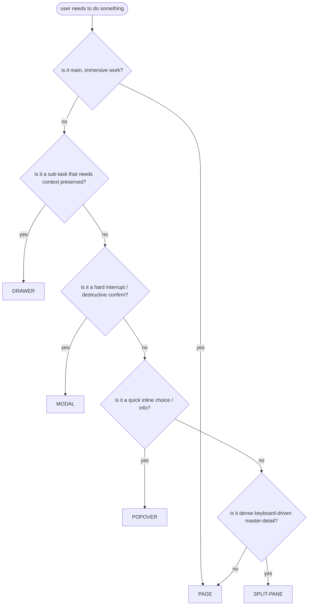

# Stage 1 — IA Containers (page / drawer / modal / popover / split-pane)

> Container choice is layer ② of the Five-Layer Blade. AI's default is "put everything on one page" (article line 1483). This file is the decision tree that stops that.

## The decision tree

## The five containers

### Page
- **Use when:** main, immersive, complex task — editor, multi-step create, data analysis, permission config.
- **Why:** full real estate, establishes structure, supports deep focus.
- **Don't use when:** it's a sub-task that should preserve the user's place in a list → use Drawer.
- **Article:** line 1563 — "页面适合复杂、重要、需要沉浸的任务...但页面不能变成垃圾场."

### Drawer (right-side by default)
- **Use when:** sub-task that needs the parent context visible — detail view from a list, edit without losing scroll position.
- **Why:** preserves where the user was, lets them batch through items without back-button navigation.
- **Don't use when:** the content is too wide (financial tables) or the task is immersive (deep editing) → use Page.
- **Article:** line 1563 + line 2018 — "用户需要保留列表上下文."
- **Must have:** ESC to close, focus trap while open, focus returns to trigger on close, draft preserved on network failure.

### Modal
- **Use when:** hard interrupt that MUST be resolved before continuing — destructive confirm (delete account, transfer ownership), blocking decision.
- **Why:** forces a decision, blocks other interaction.
- **Don't use when:** it's just a sub-task → use Drawer. AI over-uses modals (article line 1563: "模态要慎用:它是拦路的").
- **Must have:** ESC to cancel, click-outside to cancel (unless destructive), focus trap, one primary action.

### Popover
- **Use when:** quick inline choice or info — color picker, date picker, small menu, tooltip-with-action.
- **Why:** lightweight, doesn't break flow, contextual to the trigger.
- **Don't use when:** content is complex or multi-step → use Drawer or Page.
- **Must have:** click-outside to close, ESC to close, doesn't trap focus (it's non-blocking).

### Split-pane (master-detail)
- **Use when:** dense, keyboard-driven, frequently-switching-between-items work — mail client, file browser, task manager for power users.
- **Why:** both panes always visible, no opening/closing cost, keyboard can fly between them.
- **Don't use when:** the user mainly works on one item at a time → Drawer is simpler.
- **Must have:** resizable panes, keyboard shortcut to switch pane, state of each pane preserved.

## AI's container disease

Article line 1483 nails it: **"筛选项全摊开,操作按钮全放出来,设置项全堆在一个页面,详情、编辑、权限、历史记录混在一起. 看起来功能齐全,实际像仓库倒了一地."**

The cure is **progressive disclosure** (article line 1502-1508):

- default shows search + status + role (the 3 most-used filters)
- "more filters" lives in a Drawer
- current filters show as chips above the list
- one-click clear-all
- advanced users can expand; new users aren't scared

Apply this to every Type B structure draft. A B draft that puts all filters on the page is failing layer ②.

## Container × state matrix

Every container has its own state behavior. Encode this in the state-matrix draft:

| Container | Loading | Empty | Error |
| --- | --- | --- | --- |
| Page | page-level skeleton | page-level empty (3-kind) | page-level error + retry |
| Drawer | drawer skeleton (preserves list) | drawer empty (3-kind) | inline drawer error, draft saved |
| Modal | button-loading (block re-click) | n/a (modal is action, not data) | inline modal error, preserve input |
| Popover | popover skeleton | n/a | popover error → expand to drawer |
| Split-pane | per-pane skeleton | per-pane empty | per-pane error |

A drawer that shows a page-level error toast on network failure has failed — the error must be inside the drawer, preserving the list context.

## Failure modes

| Failure | Symptom | Fix |
| --- | --- | --- |
| Everything on one page | "仓库倒了一地" | progressive disclosure: default 3, drawer for more |
| Modal overuse | every sub-task is a modal | drawer-first; modal only for hard interrupts |
| Drawer without focus management | ESC doesn't close, focus lost | drawer contract: ESC + focus-trap + focus-return |
| Container × state mismatch | drawer shows page-level error | container-state matrix above |
| No "more filters" drawer | filter wall on the page | drawer for low-frequency filters |
