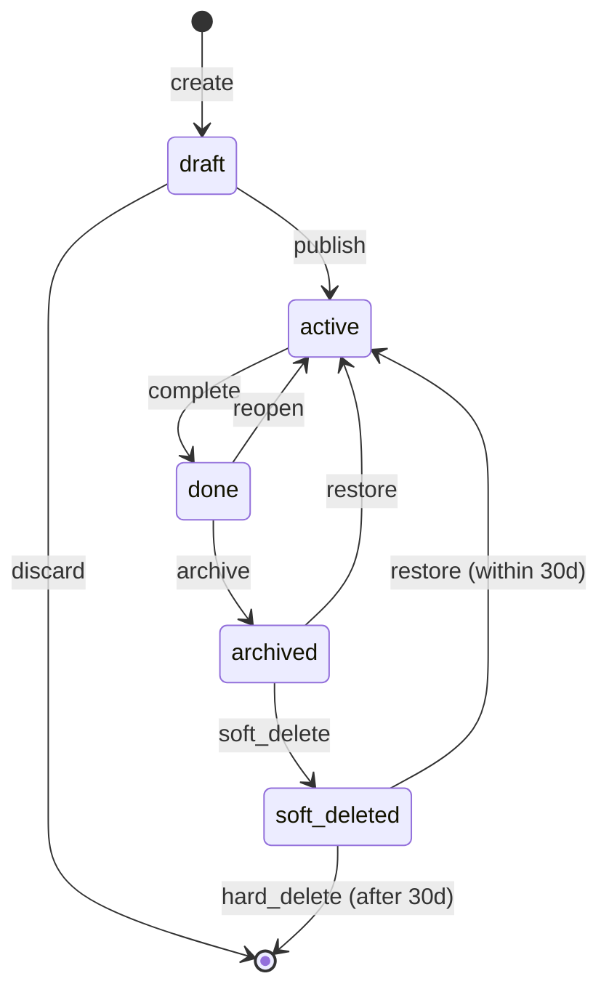

# Stage 1 — Object-State-Permission Matrix (the hardest deep layer)

> This is the skeleton under the skin. AI almost never draws it. If your Stage-1 pack has no object-state-permission matrix, you have produced skin without skeleton — regenerate.

## Why this layer matters most

Article line 608: **"正常态只能证明能演示,边界态才能证明能上线."** And the hardest edge cases live in the data: an object's lifecycle (draft / active / done / archived / deleted) crosses through states that each have different permission rules. A viewer can see "active" but not "draft". An editor can edit "active" but not "archived". A delete is soft for 30 days then hard.

If the UI doesn't encode this matrix, the user will hit a 403 on a button they could see, or lose data on a transition that had no save-draft, or see an "archived" row they couldn't act on. These are the bugs that ship when AI draws only the sunny-day list.

Article line 611 names this directly: **"对象—状态—权限矩阵:复杂产品的地图."** This skill treats it as a first-class Stage-1 draft.

## The matrix

```text
object: Task  (substitute the user's real object)

lifecycle states:
  draft → active → done → archived → (soft-deleted → hard-deleted)

        | view        | edit        | delete      | comment
--------|-------------|-------------|-------------|------------
draft   | author+,    | author+,    | author+,    | -
        | editor+     | editor+     | editor+     |
active  | team+       | assignee+,  | admin only  | team+
        |             | editor+     |             |
done    | team+       | admin only  | admin only  | team+
        |             | (reopen)    | (archive)   |
archived| admin only  | admin only  | admin only  | -
        |             | (restore)   | (hard-del)  |
soft-del| author+,    | -           | admin only  | -
(30d)   | admin only  |             | (hard-del)  |
        | (restore)   |             |             |
```

## How to draw this draft

Use a **Mermaid stateDiagram** for the lifecycle, plus a **Markdown table** for the permission matrix. Both are required — the diagram shows the transitions, the table shows who can do what at each transition.

### Mermaid lifecycle



### Markdown permission matrix

Use the table format above. One row per lifecycle state, one column per action. Each cell names the roles that can perform the action at that state, plus the transition it triggers.

## What to dig per cell

Don't fill cells with "yes/no". Fill them with the **transition + role**:

- `done / edit / admin only (reopen)` — only admin can reopen, and the edit action IS the reopen transition.
- `archived / view / admin only` — archived items disappear from regular lists; only admins see them in an archive view.
- `soft_deleted / view / author+ (restore)` — the author can still see their soft-deleted item for 30 days and restore it.

The matrix is not documentation — it IS the spec. Stage 2 restores the UI against this matrix: every button's disabled state, every list's filter, every "you don't have permission" wording comes from here.

## Layer-relevant formats

- **Mermaid stateDiagram** (lifecycle) — required.
- **Markdown permission matrix table** — required.
- ASCII wireframe of the list at each lifecycle state — optional but powerful (shows what a viewer vs author vs admin sees).

## Pass criterion

A reader can answer, for every role × every state:
1. what do they SEE? (which rows, which buttons, which fields)
2. what can they DO? (which actions are enabled, which are disabled-with-reason)
3. what transition does each action trigger?
4. what happens on failure? (403 wording, draft saved, etc.)

If any role × state cell is blank or "TBD", the matrix is incomplete — the UI built on it will have a bug there.

## Common failures

| Failure | Symptom | Fix |
| --- | --- | --- |
| Only happy-path states | draft → active → done, nothing else | add archived, soft-deleted, restore paths |
| Permission = "admin / user" only | no role nuance | add author, assignee, editor, viewer, admin |
| Cells say "yes/no" | no transition named | each cell = role + transition it triggers |
| No soft-delete | deletes are instant and irreversible | add 30-day soft-delete + restore window |
| No "see but can't act" state | viewer sees buttons that 403 | encode view-only vs edit-disabled-with-reason |

## When to skip this draft

Almost never. Any product with CRUD on a persistent object needs this. The only exceptions:
- a single-screen tool with no persistence (a calculator, a converter)
- a pure read-only view (analytics dashboard with no edit)

If in doubt, draw it. The cost of drawing it is 20 minutes; the cost of shipping without it is a P0 bug.
