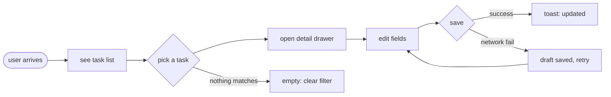
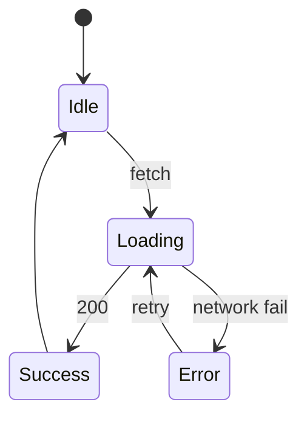
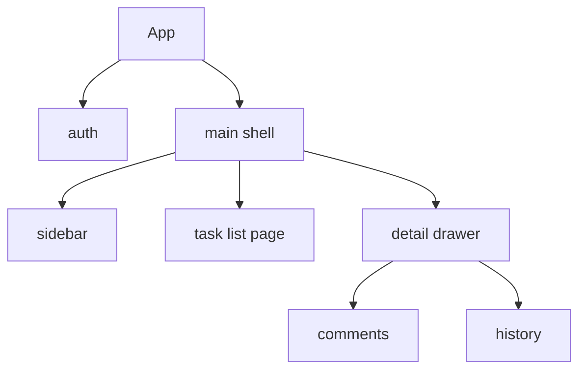

# Stage 1 — Output Formats (four kinds, when to use each)

> Every Stage-1 draft emits AT LEAST the 2 formats most relevant to its layer. Use this as the template library. Don't emit all 4 for every draft — that's waste. Pick by layer.

## Format 1 — ASCII wireframe (for ② Structure)

Carries: block layout, spatial relations, one-screen-visible structure. Best for IA drafts.

### Template

```text
┌─────────────────────────────────────────────────────────────┐
│ TOPBAR  [logo]   search            [notif] [avatar ▾]        │
├──────────┬──────────────────────────────────┬────────────────┤
│ SIDEBAR  │  MAIN: task list                 │ DRAWER (opt)   │
│          │  ┌────────────────────────────┐  │  task detail   │
│ ▸ Inbox  │  │ □ Task title       assignee│  │                │
│ ▸ Today  │  │   due · status             │  │  [edit][del]   │
│ ▸ Proj…  │  └────────────────────────────┘  │                │
│          │  ┌────────────────────────────┐  │  comments:     │
│          │  │ □ …                        │  │  - …           │
│          │  └────────────────────────────┘  │                │
│          │                                  │                │
│          │  [＋ New task]   primary         │                │
├──────────┴──────────────────────────────────┴────────────────┤
│ FOOTER  status: online · 12 tasks · shortcut: ?              │
└─────────────────────────────────────────────────────────────┘
```

Rules:
- Use box-drawing chars (`┌─┐│└─┘`), not pipes-and-dashes.
- Label every block in CAPS.
- Mark the primary action explicitly (`primary`).
- Show one screen, not three. For multi-screen, draw multiple ASCII frames.
- No color, no real data — placeholder names (`Task title`, `assignee`).

## Format 2 — Mermaid diagram (for ① Task, ③ State, object-state-permission)

Carries: flow, IA tree, state transition, object lifecycle, permission logic.

### Task flow (① Task)



### State transition (③ State)



### IA tree (② Structure)



### Object lifecycle (object-state-permission)

See `stage1-object-state-permission.md` — uses `stateDiagram-v2` with roles annotated on transitions.

Rules:
- One Mermaid per concept. Don't cram two flows in one diagram.
- Label edges with the **trigger**, not the result.
- Mark the recovery paths (retry, restore, undo) — these are the moments AI skips.

## Format 3 — Grayscale image-wireframe prompt (for ② Structure)

Carries: visual proportion, whitespace rhythm, density feel. Best for IA drafts when the user wants a "looks like" reference, not just a text layout.

### Template (feed to an image model)

```text
grayscale wireframe of a [product type] screen, [layout variant]:

layout:
- top bar: thin, [logo] left, [search] center, [avatar] right
- left sidebar: narrow, vertical nav, 4-5 items
- main area: [list/kanban/grid], generous whitespace, [N] items visible
- optional right drawer: collapsed by default, slides in on click
- footer: minimal status strip

style:
- grayscale only, NO color, NO gradient, NO shadow, NO real photos
- hand-drawn wireframe feel, thin gray lines, neutral gray fills
- placeholder content (lorem ipsum, generic icons), no real brand
- 16:9 aspect, desktop, 1440px feel
- annotations allowed (small labels pointing to blocks)

do NOT:
- add color, gradient, or shadow
- make it look polished or final
- include real data, real logos, real people
- add charts, calendars, or features not in the layout description
```

Rules:
- Always say `grayscale only, NO color` — Stage 1 must stay low-fi (article line 4008).
- Describe the **layout**, not the **paint**. Paint is Stage 2.
- Include the `do NOT` block — image models will otherwise polish it into a plastic hi-fi.

## Format 4 — Markdown structure doc (for ① Task, ③ State, ④ System, ⑤ Tradeoff)

Carries: blocks / components / state matrix / container rationale / object-state-permission table.

### Template

```markdown
## Draft: [name] — [layer] — [type A/B]

### Blocks
| Block | Component | Purpose | State coverage |
|---|---|---|---|
| top bar | TopBar | nav, search, profile | loading: skeleton search; error: offline banner |
| list | TaskList | show tasks | loading: skeleton; empty: 3-kind; error: retry-inline |
| drawer | TaskDrawer | detail + edit | loading: skeleton; error: draft saved |
| ... | ... | ... | ... |

### State matrix (core component: Button)
| State | Visual | Copy | Behavior |
|---|---|---|---|
| default | primary bg | "Save" | clickable |
| hover | bg darken 8% | "Save" | cursor pointer |
| active | bg darken 16%, scale 0.98 | "Save" | pressed feedback |
| focus | 2px ring outside | "Save" | keyboard reachable |
| disabled | 40% opacity, no-shadow | "Save" | aria-disabled, tooltip "fill required fields" |
| loading | spinner left of label | "Saving…" | block re-click, keep text |
| success | flash green 200ms → default | "Saved" toast | confirm done |
| error | shake 200ms, ring red | "Save failed — retry" inline | keep draft, allow retry |

### Container rationale
- list → page (main real estate, immersive)
- detail → drawer (preserve list context, don't lose place)
- confirm-delete → modal (hard interrupt, destructive)
- filter → drawer (low-frequency, complex)

### Tradeoff note (⑤)
- **good:** drawer keeps the list visible, so the user doesn't lose place when editing
- **cost:** drawer is narrower, can't show wide tables in detail
- **fit:** task management where context matters
- **unfit:** financial data with wide rows — use full page there
- **layer dug:** ② Structure + ⑤ Tradeoff
- **拼 into product:** pairs with the task-flow draft (①) — the flow's "edit" step happens in this drawer
```

Rules:
- Tables for blocks, states, permissions — never prose.
- Every block row carries its state coverage — no state-less blocks.
- Container rationale always answers "why this container, not the alternative".
- Tradeoff note is mandatory — no draft ships without one.

## Layer → format cheat sheet

| Draft type | Layer | Format 1 ASCII | Format 2 Mermaid | Format 3 grayscale | Format 4 Markdown |
|---|---|---|---|---|---|
| task-flow | ① Task | — | **required** | — | **required** |
| state-matrix | ③ State | optional | **required** | — | **required** |
| object-state-permission | ③ State (deep) | optional | **required** | — | **required** |
| system | ④ System | — | optional | — | **required** |
| IA variant | ② Structure | **required** | optional | **required** | optional |
| tradeoff note | ⑤ Tradeoff | — | — | — | **required** (attached) |

**At least the two "required" formats per draft.** A draft with zero of its layer-relevant formats is incomplete — regenerate.
