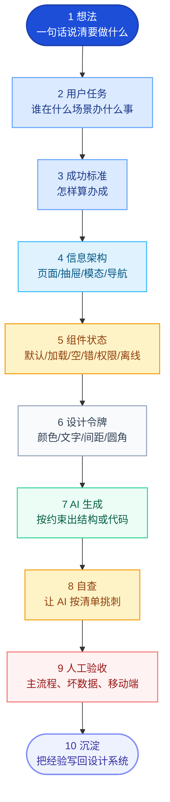

# Workflow 01 — 想法到上线的 10 步(原文权威版)

> 出处:《设计的实践》第 10 编 八(行 2227-2249)
> 定位:**Agent 执行任何任务的总流程,替代任何自拼流程**
>
> **作者原话**:「把全书压缩成一条日常工作流,就是十步。这十步不花哨,但能救命。它能防止你一上来做视觉,防止 AI 一上来写代码,防止团队一上来争审美,防止产品上线后才发现状态没补。」

## 10 步流程图(原文 Mermaid,逐字复制)



## 每步详解

### Step 1:想法 — 一句话说清要做什么

**做什么**:把用户的原始想法(通常很散)压成一句话。

**原文例子**:
- 原始想法:"我想做一个团队任务管理工具,可以创建任务、分配成员、看进度、评论、提醒,还要有 AI 总结,界面类似 Linear 和 Notion。"
- 压成一句:"为 20–200 人的软件团队,提供一个能快速创建、分配、跟进任务的协作工具,让项目经理和工程师每天少花时间找任务、问进度、追状态。"

**纪律**:**刀不狠,产品就会胖;产品一胖,新用户就迷路。**

### Step 2:用户任务 — 谁在什么场景办什么事

**做什么**:写用户任务清单(不写功能清单)。

**模板**(详见 [02-design-task-brief.md](./02-design-task-brief.md)):
```
| 用户 | 真实任务 | 成功标准 | 先做吗? |
| 项目经理 | 创建任务并分配给成员 | 任务被创建、负责人清楚、截止日期明确 | 先做 |
| 工程师 | 查看自己今天要处理什么 | 能快速找到优先任务和状态 | 先做 |
| 项目经理 | 查看项目整体进度 | 知道哪些任务卡住、哪些逾期 | 第二阶段 |
...
```

**纪律**:**功能清单容易害人。用户不是来使用功能清单的,用户是来办任务的。**

### Step 3:成功标准 — 怎样算办成

**做什么**:每个任务写清楚"怎样算完成"——用户看见什么、点了什么、系统保存了什么。

**反模式**:"用户能创建任务" — 太空。
**好模式**:"用户点击创建按钮 → 表单出现 → 填完 → 任务出现在列表顶部并短暂高亮 → 收到 Toast'已创建'"。

### Step 4:信息架构 — 页面/抽屉/模态/导航

**做什么**:画结构,不画漂亮页面。决定:
- 哪些信息进**页面**(主战场)
- 哪些进**抽屉**(子任务、保留上下文)
- 哪些进**模态**(必须立刻决断的危险动作)
- 哪些进**Popover**(轻量补充)
- 哪些进**Toast**(短反馈)

参考 [patterns/03-container-decision.md](../patterns/03-container-decision.md)。

### Step 5:组件状态 — 默认/加载/空/错/权限/离线

**做什么**:列组件清单,每个组件必须填状态矩阵。

**任务详情抽屉的状态矩阵例子**:

| 状态 | 用户看到 | 系统保证 | 坏设计风险 |
|---|---|---|---|
| 加载中 | 抽屉骨架屏 | 保留列表上下文 | 白屏,用户以为点错 |
| 正常 | 标题、状态、负责人、描述、评论 | 主信息可扫读 | 信息堆叠无主次 |
| 评论提交中 | 按钮 loading,输入框保留 | 防重复提交 | 重复评论 |
| 评论失败 | 就地错误,可重试 | 草稿不能丢 | 用户写的内容消失 |
| 权限不足 | 说明不能编辑的原因 | 允许查看可见信息 | 按钮禁用但不解释 |
| 离线 | 提示离线,只读或本地草稿 | 不要假装保存成功 | 数据不同步,信任崩塌 |

**纪律**:**状态矩阵一写,页面就开始有产品感了。因为它不再只是画面,而是在处理真实使用中的事故。**

### Step 6:设计令牌 — 颜色/文字/间距/圆角

**做什么**:建立基本秩序,不让页面临时长出来颜色。

**MVP 第一版令牌**(原文行 2568-2596):

| 令牌 | 用途 | 说明 |
|---|---|---|
| `color.bg.canvas` | 页面背景 | 安静,不抢内容 |
| `color.bg.surface` | 卡片、抽屉、表格 | 承载主要内容 |
| `color.text.primary` | 标题、正文 | 必须高对比 |
| `color.text.secondary` | 说明、辅助 | 弱化但可读 |
| `color.action.primary` | 主按钮、链接 | 小面积使用 |
| `color.danger` | 删除、失败、高风险 | 只给危险和错误 |
| `space.2 / 4 / 6 / 8` | 间距 | 用 4/8 点网格 |
| `radius.sm / md / lg` | 圆角 | 按钮、输入框、卡片分层 |

**纪律**:**MVP 的视觉目标不是惊艳,而是可靠、清楚、可维护。没有令牌,AI 写代码会越写越散,工程师也会各写各的。**

### Step 7:AI 生成 — 按约束出结构或代码

**做什么**:前面 6 步都齐了,才让 AI 写。但只允许它**按图施工**,不能自由发挥。

**原文提示词模板**(行 2599-2610):
```text
请基于以下产品任务、信息架构、组件状态和视觉令牌,生成 [产品名] 的 MVP 前端实现。

必须遵守:
1. 不新增未定义功能;
2. 一屏只有一个主按钮:[主按钮名];
3. 详情使用右侧抽屉;
4. 所有异步操作必须有 loading;
5. 所有失败必须保留用户输入;
6. 使用设计令牌,不直接写死颜色;
7. 桌面为主,同时给出移动端结构;
8. 输出后必须自查 P0/P1/P2 问题。

请先输出文件结构和组件拆分,不要直接给整页大代码。
```

**关键纪律**:**"不要直接给整页大代码"** 很关键。大代码看似完整,实际难审。先看文件结构和组件拆分,能判断它有没有把产品拆对。

**AI 协作三角色**(详见 [03-ai-collaboration-roles.md](./03-ai-collaboration-roles.md)):调研员 / 草图员 / 执行员。

### Step 8:自查 — 让 AI 按清单挑刺

**做什么**:让 AI 自己按 P0/P1/P2 清单挑刺(详见 [04-p0p1p2-review.md](./04-p0p1p2-review.md))。

**纪律**:**别信 AI 说"完成了"。让它出示证据:每个状态长什么样?移动端截图?错误文案?撤销窗口?**

### Step 9:人工验收 — 主流程、坏数据、移动端

**做什么**:人脑走一遍。

**原文给的 10 步验收路径**(行 2613-2623,以任务管理为例):
1. 创建任务
2. 分配负责人
3. 设置截止日期
4. 在列表找到任务
5. 打开详情抽屉
6. 修改状态
7. 添加评论
8. 模拟评论提交失败
9. 关闭抽屉,返回原列表位置
10. 手机端走一遍同样流程

**纪律**:**如果这十步有一步不顺,就先修这一步。不要用新功能掩盖旧问题。**

### Step 10:沉淀 — 把经验写回设计系统

**做什么**:每个项目跑完,把发现的新模式 / 新反例 / 新状态 / 新文案 沉淀回设计系统。

**纪律**:**设计系统不是库存,是活规矩。每次项目里发现一个常见问题,就把它沉淀成组件状态、模式、反例或提示词。让下一次不要靠记忆解决,让系统替团队记住。**

详见 [patterns/05-design-system-governance.md](../patterns/05-design-system-governance.md)。

## 反模式(每步可能犯的错)

| 步 | 反模式 | 病根 |
|---|---|---|
| 1 | 想法太散,什么都想做 | 没压成一句话 |
| 2 | 写功能清单,不写用户任务 | 站在产品视角,不是用户视角 |
| 3 | 成功标准空泛("用户能创建任务") | 没说具体看见什么、点什么 |
| 4 | 直接画漂亮页面 | 没先定 IA |
| 5 | 只画默认态 | 漏加载/空/错/权限/离线 |
| 6 | 临时常颜色、临时常圆角 | 没建立令牌 |
| 7 | 让 AI 自由发挥 | 没给约束 |
| 7 | AI 给整页大代码 | 没要文件结构先 |
| 8 | 信 AI 说"完成了" | 没让它出示证据 |
| 9 | 只走 happy path | 没走坏数据/移动端 |
| 10 | 项目跑完不沉淀 | 经验流失,下次重造 |

## 与 Stage 0/1/2 的对应关系

| 10 步 | skill 的 Stage |
|---|---|
| Step 1 想法 | Stage 0 之前(Intent Brief) |
| Step 2 用户任务 | Stage 0(判断卡 0 任务场)+ Task Card |
| Step 3 成功标准 | Anti-Plastic Test |
| Step 4 IA | Stage 1 五层切片(②Structure) |
| Step 5 组件状态 | Stage 1 五层切片(③State)+ patterns/ |
| Step 6 令牌 | Stage 2 E1 token 三层 |
| Step 7 AI 生成 | Stage 2 高保真还原 |
| Step 8 自查 | L1-L6 自检 |
| Step 9 人工验收 | 三道门 QA + qa-*.md |
| Step 10 沉淀 | patterns/05 治理 |

**纪律**:**Agent 必须按这 10 步走,不能跳。任何"我直接做 Stage 2"都是反模式。**
