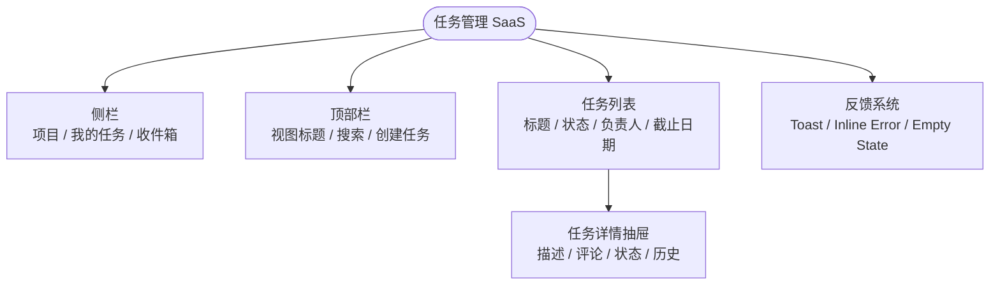

# Workflow 05 — 完整项目实战 8 步(原文权威版)

> 出处:《设计的实践》第 12 编(行 2466-2640)
> 定位:**做复杂产品(从想法到上线)的完整流程,基于任务管理 SaaS 案例**
>
> **作者原话**:「一个产品不是从漂亮页面开始,而是从用户任务开始。想法压成任务,任务变成结构,结构拆成组件,组件补齐状态,状态接入令牌,AI 才开始生成,最后用验收清单把它打结实。**按这个顺序,页面才会长成产品;顺序反了,产品就会长成一堆页面。**」

## 8 步流程(原文 verbatim)

```
Step 1 把想法压成一句可靠的话
   ↓
Step 2 写用户和任务,不写功能清单
   ↓
Step 3 画信息架构,不画漂亮页面
   ↓
Step 4 定义组件和状态
   ↓
Step 5 建立视觉令牌,不让页面临时长出来
   ↓
Step 6 让 AI 生成第一版,但只允许它按图施工
   ↓
Step 7 验收第一版,不要急着加功能
   ↓
Step 8 第二阶段再扩展,而不是第一天就做满
```

## Step 1:把想法压成一句可靠的话

**做什么**:把用户的原始想法(通常很散)压成一句话。

**原文例子**(行 2471-2476):
- **原始想法**:"我想做一个团队任务管理工具,可以创建任务、分配成员、看进度、评论、提醒,还要有 AI 总结,界面类似 Linear 和 Notion。"
- **压成一句**:"为 20–200 人的软件团队,提供一个能快速创建、分配、跟进任务的协作工具,让项目经理和工程师每天少花时间找任务、问进度、追状态。"

**压完后**:**方向就清楚了。我们不是先做 AI 总结,不是先做报表,不是先做复杂权限,也不是先做漂亮 dashboard。我们先解决一个最基本的问题:团队每天怎么创建任务、找到任务、更新任务状态。**

**纪律**:
> **原文金句**:「这就是 MVP 的第一刀。**刀不狠,产品就会胖;产品一胖,新用户就迷路。**」

## Step 2:写用户和任务,不写功能清单

**做什么**:写用户任务清单(不写功能清单)。

**原文模板**(行 2480-2503):

| 用户 | 真实任务 | 成功标准 | 先做吗? |
|---|---|---|---|
| 项目经理 | 创建任务并分配给成员 | 任务被创建、负责人清楚、截止日期明确 | **先做** |
| 工程师 | 查看自己今天要处理什么 | 能快速找到优先任务和状态 | **先做** |
| 项目经理 | 查看项目整体进度 | 知道哪些任务卡住、哪些逾期 | 第二阶段 |
| 管理员 | 设置成员权限 | 不同成员有正确访问边界 | 第二阶段 |
| 团队负责人 | 生成周报和风险摘要 | AI 总结可信、可追溯 | 第三阶段 |

**纪律**:
> **原文金句**:「功能清单很容易写,也很容易害人……**用户不是来使用功能清单的,用户是来办任务的**。一写成任务,优先级就出来了。第一阶段不做复杂报表,不做 AI 总结,不做权限模板。不是因为它们不重要,而是因为它们不是第一条生命线。**产品早期要先有一根主梁,再盖楼层。**」

## Step 3:画信息架构,不画漂亮页面

**做什么**:任务明确以后,先画结构。

**原文例子**(行 2505-2510)—— 任务管理 SaaS 第一版只有 4 个主区域:
1. **侧栏**:项目与视图入口
2. **顶部栏**:当前视图、搜索、创建任务
3. **任务列表**:任务标题、状态、负责人、截止日期、优先级
4. **任务详情抽屉**:详情、描述、评论、历史

**为什么用抽屉**:用户从列表点开任务详情时,**需要保留列表上下文**。他可能只是快速改状态、补评论、看描述,不应该每次跳到新页面再回来。抽屉就是这个场景的合适容器。

**原文结构图**(行 2513-2524 Mermaid):


**纪律**:
> **原文金句**:「这个结构不花哨,但能跑主任务。**一个产品的第一版,不怕朴素,怕散。朴素可以慢慢打磨;散了就要推倒重来。**」

## Step 4:定义组件和状态

**做什么**:列组件清单,每个组件必须填状态矩阵。

**组件清单**(原文行 2527-2535):
- Button:主、次、危险、文字
- Input:搜索、标题、评论输入
- Task Row:任务行
- Status Badge:状态标签
- Avatar:负责人
- Drawer:详情抽屉
- Empty State:空列表、筛选无结果、无权限
- Toast / Inline Error:反馈

**状态矩阵例子**(原文行 2536-2565,任务详情抽屉):

| 状态 | 用户看到什么 | 系统要保证什么 | 坏设计风险 |
|---|---|---|---|
| 加载中 | 抽屉骨架屏 | 保留列表上下文 | 白屏,用户以为点错 |
| 正常 | 标题、状态、负责人、描述、评论 | 主信息可扫读 | 信息堆叠,无主次 |
| 评论提交中 | 按钮 loading,输入框保留 | 防重复提交 | 重复评论 |
| 评论失败 | 就地错误,可重试 | 草稿不能丢 | 用户写的内容消失 |
| 权限不足 | 说明不能编辑的原因 | 允许查看可见信息 | 按钮禁用但不解释 |
| 离线 | 提示离线,只读或本地草稿 | 不要假装保存成功 | 数据不同步,信任崩塌 |

**纪律**:
> **原文金句**:「状态矩阵一写,**页面就开始有产品感了。因为它不再只是画面,而是在处理真实使用中的事故**。」

## Step 5:建立视觉令牌,不让页面临时长出来

**做什么**:即使是 MVP,也要有令牌。

**原文令牌表**(行 2568-2596):

| 令牌 | 用途 | 说明 |
|---|---|---|
| `color.bg.canvas` | 页面背景 | 安静,不抢内容 |
| `color.bg.surface` | 卡片、抽屉、表格区域 | 承载主要内容 |
| `color.text.primary` | 标题、正文 | 必须高对比 |
| `color.text.secondary` | 说明、辅助信息 | 弱化但可读 |
| `color.action.primary` | 主按钮、链接 | 小面积使用 |
| `color.danger` | 删除、失败、高风险 | 只给危险和错误 |
| `space.2 / 4 / 6 / 8` | 间距 | 用 4/8 点网格 |
| `radius.sm / md / lg` | 圆角 | 按钮、输入框、卡片分层 |

**纪律**:
> **原文金句**:「MVP 的视觉目标不是惊艳,而是**可靠、清楚、可维护**。你可以晚一点做品牌插画,晚一点做复杂动效,但**不能晚一点做令牌**。没有令牌,AI 写代码会越写越散,工程师也会各写各的。」

## Step 6:让 AI 生成第一版,但只允许它按图施工

**做什么**:前面 5 步齐了,才让 AI 写。但只允许它按图施工。

**原文提示词模板**(行 2599-2610):
```text
请基于以下产品任务、信息架构、组件状态和视觉令牌,
生成 [产品名] 的 MVP 前端实现。

必须遵守:
1. 不新增未定义功能;
2. 一屏只有一个主按钮:[主按钮名];
3. 详情使用右侧抽屉;
4. 所有异步操作必须有 loading;
5. 所有失败必须保留用户输入;
6. 使用设计令牌,不直接写死颜色;
7. 桌面为主,同时给出移动端结构;
8. 输出后必须自查 P0/P1/P2 问题。

请先输出文件结构和组件拆分,不要直接给整页大代码。
```

**关键纪律**:
> **原文金句**:「这句"不要直接给整页大代码"很关键。**大代码看似完整,实际难审**。先看文件结构和组件拆分,能判断它有没有把产品拆对。拆对了再写代码;拆错了,别让它继续。」

## Step 7:验收第一版,不要急着加功能

**做什么**:第一版出来后,**最容易犯的错是马上加功能**。先验收主流程。

**原文验收路径**(行 2613-2623,任务管理 SaaS 的 10 步):
1. 创建任务
2. 分配负责人
3. 设置截止日期
4. 在列表找到任务
5. 打开详情抽屉
6. 修改状态
7. 添加评论
8. 模拟评论提交失败
9. 关闭抽屉,返回原列表位置
10. 手机端走一遍同样流程

**纪律**:
> **原文金句**:「如果这十步有一步不顺,就先修这一步。**不要用新功能掩盖旧问题**。很多产品越做越乱,就是因为每次发现基础体验不好,就想加一个新功能转移注意力。**真正成熟的做法,是把主流程磨到顺,再扩展**。」

## Step 8:第二阶段再扩展,而不是第一天就做满

**做什么**:第一阶段主流程稳定后,第二阶段才扩展。

**原文扩展计划**(行 2625-2637):

**第二阶段**:
- 项目视图:按项目组织任务
- 我的任务:按负责人聚合
- 筛选和排序:更多筛选进入抽屉
- 基础通知:被分配、被评论、截止前提醒
- 简单权限:管理员、成员、访客

**第三阶段**:
- 报表
- 自动周报
- AI 风险摘要
- 依赖关系
- 跨项目资源视图

**纪律**:
> **原文金句**:「分阶段不是保守,而是诚实。**产品复杂度会长,关键是让它按骨架长,而不是乱长**。树要先有主干,再长枝叶;产品要先有主流程,再长高级功能。」

## 第 12 编总结(原文金句)

> 「一个产品不是从漂亮页面开始,而是从用户任务开始。**想法压成任务,任务变成结构,结构拆成组件,组件补齐状态,状态接入令牌,AI 才开始生成,最后用验收清单把它打结实。按这个顺序,页面才会长成产品;顺序反了,产品就会长成一堆页面。**」

## 8 步 vs 10 步 vs Stage 0/1/2 的对应

| 8 步项目 | 10 步工作流 | skill 的 Stage |
|---|---|---|
| Step 1 想法压成一句 | Step 1 想法 | Stage 0 之前(Intent Brief) |
| Step 2 用户任务 | Step 2 用户任务 | Stage 0(判断卡 0)+ 设计任务单 |
| Step 3 IA | Step 4 IA | Stage 1 ②Structure |
| Step 4 组件状态 | Step 5 组件状态 | Stage 1 ③State + patterns/ |
| Step 5 令牌 | Step 6 令牌 | Stage 2 E1 |
| Step 6 AI 生成 | Step 7 AI 生成 | Stage 2 高保真 |
| Step 7 验收 | Step 8 + Step 9 | L1-L6 + 三道门 |
| Step 8 第二阶段扩展 | (10 步外) | patterns/05 治理(沉淀) |

**Agent 使用纪律**:做**单页/简单需求**用 10 步;做**复杂产品(多页面/多对象/多角色)**用 8 步。8 步比 10 步多了一步"分阶段扩展",这是产品级开发必须的。
